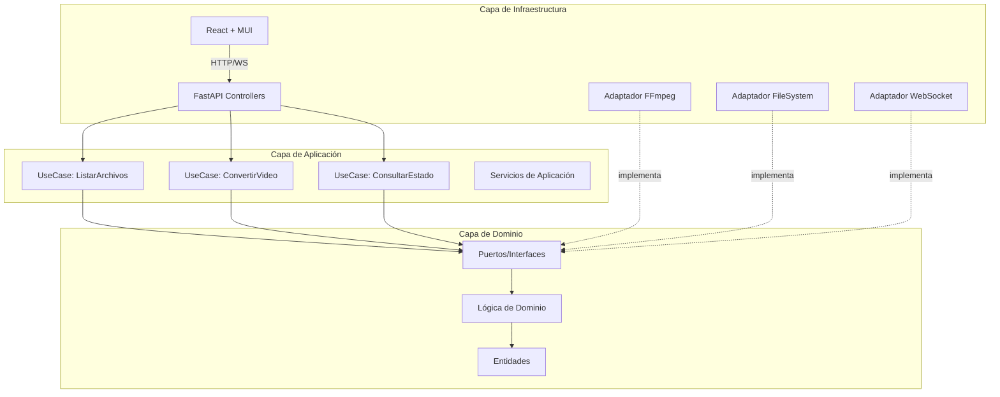
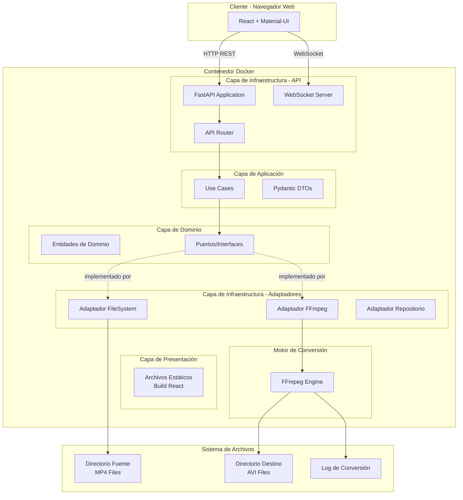
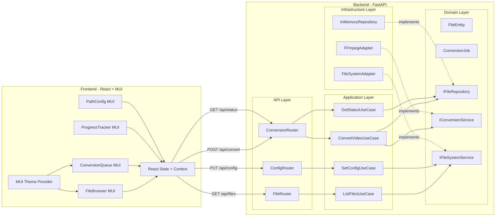
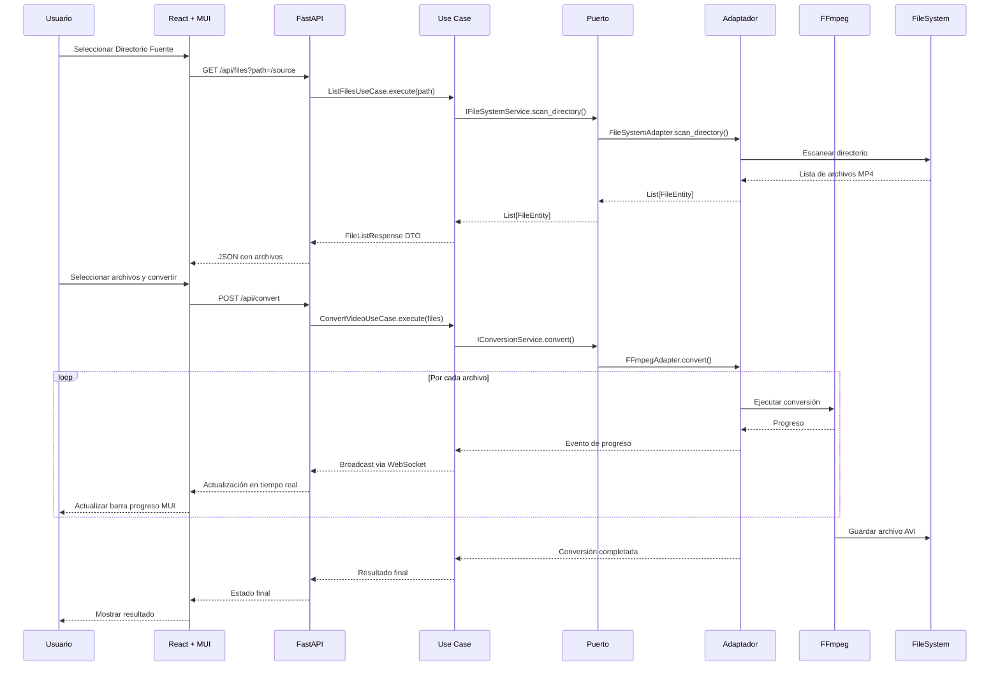

# Documento de Diseño Técnico

## Sistema Conversor de MP4 a AVI

**Versión:** 2.0  
**Fecha:** Enero 2025  
**Feature:** mp4-to-avi-converter

---

## Resumen Ejecutivo

Este documento describe el diseño técnico del Sistema Conversor de MP4 a AVI, una aplicación web que permite a los usuarios convertir archivos de video del formato MP4 al formato AVI. El sistema implementa una **arquitectura hexagonal (Ports & Adapters)** con un backend en **Python con FastAPI** y un frontend en **React con Material-UI**, todo desplegado mediante contenedores Docker para garantizar portabilidad y facilidad de despliegue.

La arquitectura hexagonal garantiza:
- **Alta testabilidad** mediante inversión de dependencias
- **Desacoplamiento** entre lógica de negocio e infraestructura
- **Flexibilidad** para intercambiar componentes sin modificar el núcleo
- **Mantenibilidad** a largo plazo del código

---

## Overview

### Propósito

El sistema proporciona una interfaz web intuitiva para la conversión por lotes de archivos MP4 a AVI, permitiendo a usuarios sin conocimientos técnicos realizar conversiones de video de manera eficiente.

### Alcance

- Interfaz web profesional con React y Material-UI
- API REST robusta con FastAPI y documentación automática OpenAPI
- Motor de conversión basado en FFmpeg
- Soporte para conversión por lotes (hasta 100 archivos)
- Seguimiento de progreso en tiempo real mediante WebSockets
- Arquitectura hexagonal para alta testabilidad y mantenibilidad
- Despliegue containerizado con Docker

### Objetivos de Diseño

1. **Simplicidad:** Interfaz intuitiva que no requiera conocimientos técnicos
2. **Robustez:** Manejo graceful de errores y recuperación
3. **Escalabilidad:** Arquitectura modular que permita futuras extensiones
4. **Portabilidad:** Despliegue consistente en cualquier plataforma con Docker
5. **Testabilidad:** Arquitectura hexagonal que facilita tests unitarios aislados
6. **Mantenibilidad:** Separación clara de responsabilidades entre capas

---

## Architecture

### Arquitectura Hexagonal (Ports & Adapters)

El sistema implementa el patrón de **Arquitectura Hexagonal**, también conocido como **Ports & Adapters**. Este patrón arquitectónico separa el núcleo de la aplicación (dominio y lógica de negocio) de los componentes externos (infraestructura, APIs, bases de datos).

#### Principios Fundamentales



#### Capas de la Arquitectura

| Capa | Responsabilidad | Componentes |
|------|-----------------|-------------|
| **Dominio** | Lógica de negocio pura, entidades, reglas de validación | Entidades, Value Objects, Puertos (interfaces) |
| **Aplicación** | Casos de uso, orquestación del flujo | Use Cases, Servicios de Aplicación, DTOs |
| **Infraestructura** | Implementación de puertos, servicios externos | Adaptadores, Controllers, External Services |
| **Presentación** | Interfaz de usuario | React Components, MUI Components |

### Diagrama de Arquitectura General



### Diagrama de Componentes Detallado



### Flujo de Datos General



---

## Components and Interfaces

### Estructura del Proyecto Python

```
backend/
├── app/
│   ├── __init__.py
│   ├── main.py                      # Punto de entrada FastAPI
│   ├── config.py                    # Configuración con Pydantic Settings
│   │
│   ├── domain/                      # CAPA DE DOMINIO
│   │   ├── __init__.py
│   │   ├── entities/               # Entidades de dominio
│   │   │   ├── __init__.py
│   │   │   ├── file_entity.py
│   │   │   ├── conversion_job.py
│   │   │   └── conversion_status.py
│   │   ├── value_objects/          # Objetos de valor
│   │   │   ├── __init__.py
│   │   │   ├── file_path.py
│   │   │   └── conversion_options.py
│   │   ├── ports/                  # Puertos (Interfaces Abstractas)
│   │   │   ├── __init__.py
│   │   │   ├── file_repository.py
│   │   │   ├── conversion_service.py
│   │   │   └── file_system_service.py
│   │   └── exceptions/             # Excepciones de dominio
│   │       ├── __init__.py
│   │       └── domain_exceptions.py
│   │
│   ├── application/                 # CAPA DE APLICACIÓN
│   │   ├── __init__.py
│   │   ├── use_cases/              # Casos de uso
│   │   │   ├── __init__.py
│   │   │   ├── list_files.py
│   │   │   ├── convert_video.py
│   │   │   ├── get_conversion_status.py
│   │   │   ├── cancel_conversion.py
│   │   │   └── set_config.py
│   │   ├── dtos/                   # Data Transfer Objects
│   │   │   ├── __init__.py
│   │   │   ├── file_dtos.py
│   │   │   ├── conversion_dtos.py
│   │   │   └── config_dtos.py
│   │   └── services/               # Servicios de aplicación
│   │       ├── __init__.py
│   │       └── conversion_orchestrator.py
│   │
│   ├── infrastructure/              # CAPA DE INFRAESTRUCTURA
│   │   ├── __init__.py
│   │   ├── adapters/               # Adaptadores (Implementaciones)
│   │   │   ├── __init__.py
│   │   │   ├── ffmpeg_adapter.py
│   │   │   ├── filesystem_adapter.py
│   │   │   └── inmemory_repository.py
│   │   ├── websocket/              # WebSocket Manager
│   │   │   ├── __init__.py
│   │   │   └── manager.py
│   │   └── logging/                # Sistema de logs
│   │       ├── __init__.py
│   │       └── conversion_logger.py
│   │
│   └── api/                         # CAPA DE PRESENTACIÓN API
│       ├── __init__.py
│       ├── dependencies.py         # Inyección de dependencias
│       ├── routers/                # FastAPI Routers
│       │   ├── __init__.py
│       │   ├── files.py
│       │   ├── conversion.py
│       │   ├── config.py
│       │   └── health.py
│       └── middleware/             # Middleware
│           ├── __init__.py
│           └── error_handler.py
│
├── tests/
│   ├── __init__.py
│   ├── unit/
│   │   ├── __init__.py
│   │   ├── domain/
│   │   ├── application/
│   │   └── infrastructure/
│   ├── integration/
│   │   ├── __init__.py
│   │   └── test_api.py
│   └── conftest.py
│
├── requirements.txt
├── pyproject.toml
└── Dockerfile
```

### Capa de Dominio

#### Entidad: FileEntity

```python
# app/domain/entities/file_entity.py
from dataclasses import dataclass, field
from datetime import datetime
from uuid import UUID, uuid4


@dataclass
class FileEntity:
    """Entidad de dominio que representa un archivo MP4."""
    
    id: UUID = field(default_factory=uuid4)
    name: str = ""
    path: str = ""
    size: int = 0  # bytes
    last_modified: datetime = field(default_factory=datetime.now)
    
    def __post_init__(self):
        """Validaciones de dominio."""
        if not self.name:
            raise ValueError("El nombre del archivo es requerido")
        if self.size < 0:
            raise ValueError("El tamaño del archivo no puede ser negativo")
    
    @property
    def extension(self) -> str:
        """Retorna la extensión del archivo."""
        return self.name.rsplit(".", 1)[-1].lower() if "." in self.name else ""
    
    @property
    def is_mp4(self) -> bool:
        """Verifica si el archivo es MP4."""
        return self.extension == "mp4"
    
    def to_dict(self) -> dict:
        """Serializa la entidad a diccionario."""
        return {
            "id": str(self.id),
            "name": self.name,
            "path": self.path,
            "size": self.size,
            "last_modified": self.last_modified.isoformat()
        }
```

#### Entidad: ConversionJob

```python
# app/domain/entities/conversion_job.py
from dataclasses import dataclass, field
from datetime import datetime
from enum import Enum
from typing import Optional
from uuid import UUID, uuid4


class ConversionStatus(str, Enum):
    """Estados posibles de un trabajo de conversión."""
    PENDING = "pending"
    IN_PROGRESS = "in_progress"
    COMPLETED = "completed"
    FAILED = "failed"
    CANCELLED = "cancelled"


@dataclass
class FileJob:
    """Representa un archivo individual dentro de un trabajo de conversión."""
    
    file_id: UUID
    file_name: str
    source_path: str
    destination_path: str
    status: ConversionStatus = ConversionStatus.PENDING
    progress: int = 0  # 0-100
    error_message: Optional[str] = None
    started_at: Optional[datetime] = None
    completed_at: Optional[datetime] = None
    
    def start(self) -> None:
        """Inicia la conversión del archivo."""
        self.status = ConversionStatus.IN_PROGRESS
        self.started_at = datetime.now()
    
    def complete(self) -> None:
        """Marca la conversión como completada."""
        self.status = ConversionStatus.COMPLETED
        self.progress = 100
        self.completed_at = datetime.now()
    
    def fail(self, error: str) -> None:
        """Marca la conversión como fallida."""
        self.status = ConversionStatus.FAILED
        self.error_message = error
        self.completed_at = datetime.now()


@dataclass
class ConversionJob:
    """Entidad de dominio que representa un trabajo de conversión por lotes."""
    
    id: UUID = field(default_factory=uuid4)
    files: list[FileJob] = field(default_factory=list)
    status: ConversionStatus = ConversionStatus.PENDING
    created_at: datetime = field(default_factory=datetime.now)
    started_at: Optional[datetime] = None
    completed_at: Optional[datetime] = None
    
    @property
    def total_files(self) -> int:
        """Total de archivos en el trabajo."""
        return len(self.files)
    
    @property
    def completed_count(self) -> int:
        """Cantidad de archivos completados."""
        return sum(1 for f in self.files if f.status == ConversionStatus.COMPLETED)
    
    @property
    def failed_count(self) -> int:
        """Cantidad de archivos fallidos."""
        return sum(1 for f in self.files if f.status == ConversionStatus.FAILED)
    
    @property
    def remaining_count(self) -> int:
        """Cantidad de archivos pendientes."""
        return sum(1 for f in self.files if f.status in [ConversionStatus.PENDING, ConversionStatus.IN_PROGRESS])
    
    @property
    def current_file(self) -> Optional[FileJob]:
        """Archivo actualmente en conversión."""
        for file_job in self.files:
            if file_job.status == ConversionStatus.IN_PROGRESS:
                return file_job
        return None
    
    @property
    def overall_progress(self) -> int:
        """Progreso general del trabajo (0-100)."""
        if not self.files:
            return 0
        total_progress = sum(f.progress for f in self.files)
        return total_progress // len(self.files)
    
    def add_file(self, file_job: FileJob) -> None:
        """Agrega un archivo al trabajo."""
        if len(self.files) >= 100:
            raise ValueError("Máximo 100 archivos por trabajo de conversión")
        self.files.append(file_job)
    
    def start(self) -> None:
        """Inicia el trabajo de conversión."""
        self.status = ConversionStatus.IN_PROGRESS
        self.started_at = datetime.now()
    
    def complete(self) -> None:
        """Marca el trabajo como completado."""
        self.status = ConversionStatus.COMPLETED
        self.completed_at = datetime.now()
    
    def cancel(self) -> None:
        """Cancela el trabajo."""
        self.status = ConversionStatus.CANCELLED
        self.completed_at = datetime.now()
```

#### Puertos (Interfaces Abstractas)

```python
# app/domain/ports/file_repository.py
from abc import ABC, abstractmethod
from typing import Optional
from uuid import UUID

from app.domain.entities.conversion_job import ConversionJob


class IFileRepository(ABC):
    """Puerto: Repositorio para gestionar trabajos de conversión."""
    
    @abstractmethod
    async def save(self, job: ConversionJob) -> None:
        """Guarda un trabajo de conversión."""
        pass
    
    @abstractmethod
    async def find_by_id(self, job_id: UUID) -> Optional[ConversionJob]:
        """Busca un trabajo por su ID."""
        pass
    
    @abstractmethod
    async def find_all(self) -> list[ConversionJob]:
        """Retorna todos los trabajos."""
        pass
    
    @abstractmethod
    async def delete(self, job_id: UUID) -> bool:
        """Elimina un trabajo."""
        pass
    
    @abstractmethod
    async def update(self, job: ConversionJob) -> None:
        """Actualiza un trabajo existente."""
        pass
```

```python
# app/domain/ports/conversion_service.py
from abc import ABC, abstractmethod
from uuid import UUID

from app.domain.entities.conversion_job import FileJob, ConversionStatus


class IConversionService(ABC):
    """Puerto: Servicio de conversión de video."""
    
    @abstractmethod
    async def convert_file(
        self, 
        source_path: str, 
        destination_path: str,
        on_progress: callable = None
    ) -> bool:
        """
        Convierte un archivo MP4 a AVI.
        
        Args:
            source_path: Ruta del archivo fuente MP4
            destination_path: Ruta del archivo destino AVI
            on_progress: Callback para reportar progreso (0-100)
            
        Returns:
            True si la conversión fue exitosa
            
        Raises:
            ConversionError: Si la conversión falla
        """
        pass
    
    @abstractmethod
    async def cancel_conversion(self, job_id: UUID) -> bool:
        """Cancela una conversión en progreso."""
        pass
    
    @abstractmethod
    async def get_ffmpeg_version(self) -> str:
        """Retorna la versión de FFmpeg instalada."""
        pass
```

```python
# app/domain/ports/file_system_service.py
from abc import ABC, abstractmethod
from typing import Optional

from app.domain.entities.file_entity import FileEntity


class IFileSystemService(ABC):
    """Puerto: Servicio para operaciones del sistema de archivos."""
    
    @abstractmethod
    async def scan_directory(
        self, 
        path: str, 
        recursive: bool = False
    ) -> list[FileEntity]:
        """
        Escanea un directorio en busca de archivos MP4.
        
        Args:
            path: Ruta del directorio a escanear
            recursive: Si debe buscar en subdirectorios
            
        Returns:
            Lista de entidades FileEntity encontradas
            
        Raises:
            DirectoryNotFoundError: Si el directorio no existe
            DirectoryNotAccessibleError: Si no hay permisos de lectura
        """
        pass
    
    @abstractmethod
    async def validate_source_path(self, path: str) -> tuple[bool, Optional[str]]:
        """
        Valida una ruta fuente.
        
        Returns:
            Tupla (es_valido, mensaje_error)
        """
        pass
    
    @abstractmethod
    async def validate_destination_path(self, path: str) -> tuple[bool, Optional[str]]:
        """
        Valida una ruta destino.
        
        Returns:
            Tupla (es_valido, mensaje_error)
        """
        pass
    
    @abstractmethod
    async def ensure_directory_exists(self, path: str) -> None:
        """Crea el directorio si no existe."""
        pass
    
    @abstractmethod
    async def path_exists(self, path: str) -> bool:
        """Verifica si una ruta existe."""
        pass
    
    @abstractmethod
    async def has_read_permission(self, path: str) -> bool:
        """Verifica permisos de lectura."""
        pass
    
    @abstractmethod
    async def has_write_permission(self, path: str) -> bool:
        """Verifica permisos de escritura."""
        pass
```

### Capa de Aplicación

#### DTOs con Pydantic

```python
# app/application/dtos/file_dtos.py
from datetime import datetime
from typing import Optional
from pydantic import BaseModel, Field
from uuid import UUID


class FileResponseDTO(BaseModel):
    """DTO de respuesta para un archivo."""
    
    id: UUID
    name: str
    path: str
    size: int = Field(ge=0, description="Tamaño en bytes")
    last_modified: datetime
    
    model_config = {
        "json_schema_extra": {
            "example": {
                "id": "123e4567-e89b-12d3-a456-426614174000",
                "name": "video.mp4",
                "path": "/source/video.mp4",
                "size": 104857600,
                "last_modified": "2025-01-15T10:30:00"
            }
        }
    }


class FileListRequestDTO(BaseModel):
    """DTO de petición para listar archivos."""
    
    path: str = Field(max_length=4096, description="Ruta del directorio fuente")
    recursive: bool = Field(default=False, description="Búsqueda recursiva")


class FileListResponseDTO(BaseModel):
    """DTO de respuesta para lista de archivos."""
    
    files: list[FileResponseDTO]
    total: int = Field(ge=0)
    truncated: bool = Field(default=False, description="True si se truncó a 1000 archivos")
```

```python
# app/application/dtos/conversion_dtos.py
from datetime import datetime
from typing import Optional
from pydantic import BaseModel, Field, field_validator
from uuid import UUID


class ConversionRequestDTO(BaseModel):
    """DTO de petición para iniciar conversión."""
    
    file_ids: list[UUID] = Field(max_length=100, description="IDs de archivos a convertir")
    destination_path: str = Field(max_length=4096, description="Ruta del directorio destino")
    
    @field_validator('file_ids')
    @classmethod
    def validate_file_count(cls, v):
        if len(v) > 100:
            raise ValueError('Máximo 100 archivos por lote')
        if len(v) == 0:
            raise ValueError('Se requiere al menos un archivo')
        return v


class ConversionResponseDTO(BaseModel):
    """DTO de respuesta para conversión iniciada."""
    
    job_id: UUID
    status: str
    total_files: int


class FileJobStatusDTO(BaseModel):
    """DTO para estado de un archivo en conversión."""
    
    file_id: UUID
    file_name: str
    status: str
    progress: int = Field(ge=0, le=100)
    error_message: Optional[str] = None


class ConversionStatusResponseDTO(BaseModel):
    """DTO de respuesta para estado de conversión."""
    
    job_id: UUID
    status: str
    current_file: Optional[str] = None
    progress: int = Field(ge=0, le=100, description="Progreso general")
    completed_count: int
    failed_count: int
    remaining_count: int
    elapsed_time: Optional[str] = None
    files: list[FileJobStatusDTO] = []


class WebSocketMessageDTO(BaseModel):
    """DTO para mensajes WebSocket."""
    
    type: str = Field(description="Tipo de mensaje: progress, status, error")
    job_id: UUID
    data: dict
```

```python
# app/application/dtos/config_dtos.py
from pydantic import BaseModel, Field


class ConfigRequestDTO(BaseModel):
    """DTO de petición para actualizar configuración."""
    
    source_directory: str = Field(max_length=4096)
    destination_directory: str = Field(max_length=4096)


class ConfigResponseDTO(BaseModel):
    """DTO de respuesta de configuración."""
    
    source_directory: str
    destination_directory: str
    valid: bool
    error_message: str | None = None
```

#### Casos de Uso

```python
# app/application/use_cases/list_files.py
from typing import Protocol
from uuid import uuid4

from app.application.dtos.file_dtos import (
    FileListRequestDTO,
    FileListResponseDTO,
    FileResponseDTO
)
from app.domain.ports.file_system_service import IFileSystemService
from app.domain.exceptions.domain_exceptions import (
    DirectoryNotFoundError,
    DirectoryNotAccessibleError,
    PathTooLongError
)


class ListFilesUseCase:
    """Caso de uso: Listar archivos MP4 en un directorio."""
    
    def __init__(self, file_system_service: IFileSystemService):
        self._fs_service = file_system_service
    
    async def execute(self, request: FileListRequestDTO) -> FileListResponseDTO:
        """
        Ejecuta el caso de uso.
        
        Args:
            request: DTO con la ruta del directorio
            
        Returns:
            FileListResponseDTO con la lista de archivos
            
        Raises:
            PathTooLongError: Si la ruta excede 4096 caracteres
            DirectoryNotFoundError: Si el directorio no existe
            DirectoryNotAccessibleError: Si no hay permisos
        """
        # Validar longitud de ruta
        if len(request.path) > 4096:
            raise PathTooLongError(
                f"La ruta excede el máximo de 4096 caracteres: {len(request.path)}"
            )
        
        # Escanear directorio
        files = await self._fs_service.scan_directory(
            path=request.path,
            recursive=request.recursive
        )
        
        # Limitar a 1000 archivos
        truncated = len(files) > 1000
        files_to_return = files[:1000]
        
        # Convertir a DTOs
        file_dtos = [
            FileResponseDTO(
                id=file.id,
                name=file.name,
                path=file.path,
                size=file.size,
                last_modified=file.last_modified
            )
            for file in files_to_return
        ]
        
        return FileListResponseDTO(
            files=file_dtos,
            total=len(files),
            truncated=truncated
        )
```

```python
# app/application/use_cases/convert_video.py
import asyncio
from uuid import UUID

from app.application.dtos.conversion_dtos import (
    ConversionRequestDTO,
    ConversionResponseDTO
)
from app.domain.entities.conversion_job import ConversionJob, FileJob, ConversionStatus
from app.domain.ports.file_repository import IFileRepository
from app.domain.ports.conversion_service import IConversionService
from app.domain.ports.file_system_service import IFileSystemService
from app.infrastructure.websocket.manager import WebSocketManager


class ConvertVideoUseCase:
    """Caso de uso: Convertir videos MP4 a AVI."""
    
    def __init__(
        self,
        file_repository: IFileRepository,
        conversion_service: IConversionService,
        file_system_service: IFileSystemService,
        websocket_manager: WebSocketManager
    ):
        self._repository = file_repository
        self._conversion_service = conversion_service
        self._fs_service = file_system_service
        self._ws_manager = websocket_manager
        self._current_job_id: UUID | None = None
    
    async def execute(self, request: ConversionRequestDTO) -> ConversionResponseDTO:
        """
        Inicia un trabajo de conversión.
        
        Args:
            request: DTO con los IDs de archivos y ruta destino
            
        Returns:
            ConversionResponseDTO con el ID del trabajo
        """
        # Validar ruta destino
        is_valid, error = await self._fs_service.validate_destination_path(
            request.destination_path
        )
        if not is_valid:
            raise ValueError(f"Ruta destino inválida: {error}")
        
        # Crear trabajo de conversión
        job = ConversionJob()
        
        # Agregar archivos al trabajo
        for file_id in request.file_ids:
            file_entity = await self._repository.find_file_by_id(file_id)
            if not file_entity:
                continue
            
            file_job = FileJob(
                file_id=file_id,
                file_name=file_entity.name,
                source_path=file_entity.path,
                destination_path=self._generate_output_path(
                    file_entity.path, 
                    request.destination_path
                )
            )
            job.add_file(file_job)
        
        # Guardar trabajo
        await self._repository.save(job)
        
        # Iniciar procesamiento en background
        asyncio.create_task(self._process_job(job))
        
        return ConversionResponseDTO(
            job_id=job.id,
            status=job.status.value,
            total_files=job.total_files
        )
    
    async def _process_job(self, job: ConversionJob) -> None:
        """Procesa el trabajo de conversión."""
        self._current_job_id = job.id
        job.start()
        await self._repository.update(job)
        
        for file_job in job.files:
            if job.status == ConversionStatus.CANCELLED:
                break
            
            file_job.start()
            await self._repository.update(job)
            await self._broadcast_status(job)
            
            try:
                # Definir callback de progreso
                async def on_progress(progress: int):
                    file_job.progress = progress
                    await self._repository.update(job)
                    await self._broadcast_status(job)
                
                # Ejecutar conversión
                success = await self._conversion_service.convert_file(
                    source_path=file_job.source_path,
                    destination_path=file_job.destination_path,
                    on_progress=on_progress
                )
                
                if success:
                    file_job.complete()
                else:
                    file_job.fail("La conversión falló sin mensaje de error específico")
                    
            except Exception as e:
                file_job.fail(str(e))
            
            await self._repository.update(job)
            await self._broadcast_status(job)
        
        job.complete()
        await self._repository.update(job)
        await self._broadcast_status(job)
        self._current_job_id = None
    
    async def _broadcast_status(self, job: ConversionJob) -> None:
        """Transmite el estado actual via WebSocket."""
        await self._ws_manager.broadcast({
            "type": "conversion_status",
            "job_id": str(job.id),
            "status": job.status.value,
            "progress": job.overall_progress,
            "current_file": job.current_file.file_name if job.current_file else None,
            "completed_count": job.completed_count,
            "failed_count": job.failed_count,
            "remaining_count": job.remaining_count
        })
    
    def _generate_output_path(self, source_path: str, dest_dir: str) -> str:
        """Genera la ruta de salida para un archivo."""
        import os
        base_name = os.path.basename(source_path)
        name_without_ext = os.path.splitext(base_name)[0]
        return os.path.join(dest_dir, f"{name_without_ext}.avi")
```

```python
# app/application/use_cases/get_conversion_status.py
from uuid import UUID

from app.application.dtos.conversion_dtos import (
    ConversionStatusResponseDTO,
    FileJobStatusDTO
)
from app.domain.ports.file_repository import IFileRepository


class GetConversionStatusUseCase:
    """Caso de uso: Obtener estado de conversión."""
    
    def __init__(self, file_repository: IFileRepository):
        self._repository = file_repository
    
    async def execute(self, job_id: UUID) -> ConversionStatusResponseDTO | None:
        """
        Obtiene el estado actual de un trabajo de conversión.
        
        Args:
            job_id: ID del trabajo
            
        Returns:
            ConversionStatusResponseDTO o None si no existe
        """
        job = await self._repository.find_by_id(job_id)
        if not job:
            return None
        
        # Calcular tiempo transcurrido
        elapsed_time = None
        if job.started_at:
            from datetime import datetime
            elapsed = datetime.now() - job.started_at
            hours, remainder = divmod(elapsed.total_seconds(), 3600)
            minutes, seconds = divmod(remainder, 60)
            elapsed_time = f"{int(hours):02d}:{int(minutes):02d}:{int(seconds):02d}"
        
        # Mapear archivos
        file_dtos = [
            FileJobStatusDTO(
                file_id=f.file_id,
                file_name=f.file_name,
                status=f.status.value,
                progress=f.progress,
                error_message=f.error_message
            )
            for f in job.files
        ]
        
        return ConversionStatusResponseDTO(
            job_id=job.id,
            status=job.status.value,
            current_file=job.current_file.file_name if job.current_file else None,
            progress=job.overall_progress,
            completed_count=job.completed_count,
            failed_count=job.failed_count,
            remaining_count=job.remaining_count,
            elapsed_time=elapsed_time,
            files=file_dtos
        )
```

### Capa de Infraestructura

#### Adaptador FFmpeg

```python
# app/infrastructure/adapters/ffmpeg_adapter.py
import asyncio
import re
from uuid import UUID
from typing import Callable

from app.domain.ports.conversion_service import IConversionService
from app.domain.exceptions.domain_exceptions import ConversionError


class FFmpegAdapter(IConversionService):
    """Adaptador para FFmpeg - Implementación del puerto IConversionService."""
    
    def __init__(self, ffmpeg_path: str = "ffmpeg"):
        self._ffmpeg_path = ffmpeg_path
        self._cancelled_jobs: set[UUID] = set()
    
    async def convert_file(
        self, 
        source_path: str, 
        destination_path: str,
        on_progress: Callable[[int], None] = None
    ) -> bool:
        """
        Convierte un archivo MP4 a AVI usando FFmpeg.
        
        Args:
            source_path: Ruta del archivo MP4 fuente
            destination_path: Ruta del archivo AVI destino
            on_progress: Callback async para reportar progreso (0-100)
            
        Returns:
            True si la conversión fue exitosa
        """
        # Obtener duración del video primero
        duration = await self._get_video_duration(source_path)
        
        # Comando FFmpeg para conversión
        cmd = [
            self._ffmpeg_path,
            "-i", source_path,
            "-c:v", "mpeg4",      # Códec video MPEG-4
            "-q:v", "2",          # Alta calidad (1-31, menor = mejor)
            "-c:a", "mp3",        # Códec audio MP3
            "-y",                 # Sobrescribir si existe
            destination_path
        ]
        
        process = await asyncio.create_subprocess_exec(
            *cmd,
            stdout=asyncio.subprocess.PIPE,
            stderr=asyncio.subprocess.PIPE
        )
        
        # Leer stderr para obtener progreso
        stderr_output = []
        
        async def read_stderr():
            while True:
                line = await process.stderr.readline()
                if not line:
                    break
                line_str = line.decode('utf-8', errors='ignore')
                stderr_output.append(line_str)
                
                # Parsear progreso
                if duration > 0:
                    progress = self._parse_progress(line_str, duration)
                    if progress is not None and on_progress:
                        await on_progress(progress)
        
        # Ejecutar lectura en background
        read_task = asyncio.create_task(read_stderr())
        
        # Esperar a que termine el proceso
        return_code = await process.wait()
        await read_task
        
        if return_code != 0:
            error_msg = ''.join(stderr_output[-10:])  # Últimas 10 líneas
            raise ConversionError(f"FFmpeg falló con código {return_code}: {error_msg}")
        
        return True
    
    async def cancel_conversion(self, job_id: UUID) -> bool:
        """Marca un trabajo para cancelación."""
        self._cancelled_jobs.add(job_id)
        return True
    
    async def get_ffmpeg_version(self) -> str:
        """Retorna la versión de FFmpeg."""
        process = await asyncio.create_subprocess_exec(
            self._ffmpeg_path, "-version",
            stdout=asyncio.subprocess.PIPE,
            stderr=asyncio.subprocess.PIPE
        )
        stdout, _ = await process.communicate()
        first_line = stdout.decode().split('\n')[0]
        return first_line
    
    async def _get_video_duration(self, file_path: str) -> float:
        """Obtiene la duración del video en segundos."""
        process = await asyncio.create_subprocess_exec(
            "ffprobe",
            "-v", "error",
            "-show_entries", "format=duration",
            "-of", "default=noprint_wrappers=1:nokey=1",
            file_path,
            stdout=asyncio.subprocess.PIPE,
            stderr=asyncio.subprocess.PIPE
        )
        stdout, _ = await process.communicate()
        
        try:
            return float(stdout.decode().strip())
        except ValueError:
            return 0.0
    
    def _parse_progress(self, output: str, duration: float) -> int | None:
        """Parsea el progreso de la salida de FFmpeg."""
        # Buscar time=HH:MM:SS.ms
        time_match = re.search(r'time=(\d{2}):(\d{2}):(\d{2})\.(\d{2})', output)
        if time_match and duration > 0:
            hours = int(time_match.group(1))
            minutes = int(time_match.group(2))
            seconds = int(time_match.group(3))
            centiseconds = int(time_match.group(4))
            
            current_time = hours * 3600 + minutes * 60 + seconds + centiseconds / 100
            progress = min(100, int((current_time / duration) * 100))
            return progress
        
        return None
```

#### Adaptador FileSystem

```python
# app/infrastructure/adapters/filesystem_adapter.py
import os
from pathlib import Path
from datetime import datetime
from uuid import uuid4

from app.domain.ports.file_system_service import IFileSystemService
from app.domain.entities.file_entity import FileEntity
from app.domain.exceptions.domain_exceptions import (
    DirectoryNotFoundError,
    DirectoryNotAccessibleError
)


class FileSystemAdapter(IFileSystemService):
    """Adaptador para operaciones del sistema de archivos."""
    
    async def scan_directory(
        self, 
        path: str, 
        recursive: bool = False
    ) -> list[FileEntity]:
        """Escanea un directorio en busca de archivos MP4."""
        if not await self.path_exists(path):
            raise DirectoryNotFoundError(f"Directorio no encontrado: {path}")
        
        if not await self.has_read_permission(path):
            raise DirectoryNotAccessibleError(f"Sin permisos de lectura: {path}")
        
        files = []
        path_obj = Path(path)
        
        if recursive:
            pattern = "**/*.mp4"
        else:
            pattern = "*.mp4"
        
        for file_path in path_obj.glob(pattern):
            if file_path.is_file():
                stat = file_path.stat()
                file_entity = FileEntity(
                    id=uuid4(),
                    name=file_path.name,
                    path=str(file_path.absolute()),
                    size=stat.st_size,
                    last_modified=datetime.fromtimestamp(stat.st_mtime)
                )
                files.append(file_entity)
        
        # Ordenar por nombre
        files.sort(key=lambda f: f.name.lower())
        
        return files
    
    async def validate_source_path(self, path: str) -> tuple[bool, str | None]:
        """Valida una ruta fuente."""
        if not path or not path.strip():
            return False, "La ruta no puede estar vacía"
        
        if len(path) > 4096:
            return False, "La ruta excede el máximo de 4096 caracteres"
        
        if not await self.path_exists(path):
            return False, "El directorio no existe"
        
        if not await self.has_read_permission(path):
            return False, "No tiene permisos de lectura para este directorio"
        
        return True, None
    
    async def validate_destination_path(self, path: str) -> tuple[bool, str | None]:
        """Valida una ruta destino."""
        if not path or not path.strip():
            return False, "La ruta no puede estar vacía"
        
        if len(path) > 4096:
            return False, "La ruta excede el máximo de 4096 caracteres"
        
        # Crear directorio si no existe
        try:
            await self.ensure_directory_exists(path)
        except PermissionError:
            return False, "No tiene permisos para crear el directorio"
        
        if not await self.has_write_permission(path):
            return False, "No tiene permisos de escritura para este directorio"
        
        return True, None
    
    async def ensure_directory_exists(self, path: str) -> None:
        """Crea el directorio si no existe."""
        Path(path).mkdir(parents=True, exist_ok=True)
    
    async def path_exists(self, path: str) -> bool:
        """Verifica si una ruta existe."""
        return Path(path).exists()
    
    async def has_read_permission(self, path: str) -> bool:
        """Verifica permisos de lectura."""
        return os.access(path, os.R_OK)
    
    async def has_write_permission(self, path: str) -> bool:
        """Verifica permisos de escritura."""
        # Si el directorio no existe, verificar el padre
        path_obj = Path(path)
        if not path_obj.exists():
            path_obj = path_obj.parent
        return os.access(path_obj, os.W_OK)
```

#### Repositorio en Memoria

```python
# app/infrastructure/adapters/inmemory_repository.py
from uuid import UUID
from typing import Optional
from collections import OrderedDict

from app.domain.ports.file_repository import IFileRepository
from app.domain.entities.conversion_job import ConversionJob
from app.domain.entities.file_entity import FileEntity


class InMemoryRepository(IFileRepository):
    """Implementación en memoria del repositorio - Adaptador para testing/desarrollo."""
    
    def __init__(self):
        self._jobs: OrderedDict[UUID, ConversionJob] = OrderedDict()
        self._files: dict[UUID, FileEntity] = {}
    
    async def save(self, job: ConversionJob) -> None:
        """Guarda un trabajo de conversión."""
        self._jobs[job.id] = job
    
    async def find_by_id(self, job_id: UUID) -> Optional[ConversionJob]:
        """Busca un trabajo por su ID."""
        return self._jobs.get(job_id)
    
    async def find_all(self) -> list[ConversionJob]:
        """Retorna todos los trabajos."""
        return list(self._jobs.values())
    
    async def delete(self, job_id: UUID) -> bool:
        """Elimina un trabajo."""
        if job_id in self._jobs:
            del self._jobs[job_id]
            return True
        return False
    
    async def update(self, job: ConversionJob) -> None:
        """Actualiza un trabajo existente."""
        if job.id in self._jobs:
            self._jobs[job.id] = job
    
    async def save_file(self, file: FileEntity) -> None:
        """Guarda una entidad de archivo."""
        self._files[file.id] = file
    
    async def find_file_by_id(self, file_id: UUID) -> Optional[FileEntity]:
        """Busca un archivo por su ID."""
        return self._files.get(file_id)
    
    def clear(self) -> None:
        """Limpia todos los datos (útil para tests)."""
        self._jobs.clear()
        self._files.clear()
```

#### WebSocket Manager

```python
# app/infrastructure/websocket/manager.py
import json
from typing import Any
from fastapi import WebSocket


class WebSocketManager:
    """Gestor de conexiones WebSocket para broadcast de estado."""
    
    def __init__(self):
        self._active_connections: list[WebSocket] = []
    
    async def connect(self, websocket: WebSocket) -> None:
        """Acepta una nueva conexión WebSocket."""
        await websocket.accept()
        self._active_connections.append(websocket)
    
    def disconnect(self, websocket: WebSocket) -> None:
        """Remueve una conexión WebSocket."""
        if websocket in self._active_connections:
            self._active_connections.remove(websocket)
    
    async def send_personal(self, websocket: WebSocket, message: dict[str, Any]) -> None:
        """Envía un mensaje a una conexión específica."""
        await websocket.send_json(message)
    
    async def broadcast(self, message: dict[str, Any]) -> None:
        """Transmite un mensaje a todas las conexiones activas."""
        message_json = json.dumps(message)
        disconnected = []
        
        for connection in self._active_connections:
            try:
                await connection.send_text(message_json)
            except Exception:
                disconnected.append(connection)
        
        # Limpiar conexiones cerradas
        for conn in disconnected:
            self.disconnect(conn)
    
    @property
    def connection_count(self) -> int:
        """Retorna el número de conexiones activas."""
        return len(self._active_connections)
```

### Capa de API (FastAPI)

#### Aplicación Principal

```python
# app/main.py
from contextlib import asynccontextmanager
from fastapi import FastAPI
from fastapi.middleware.cors import CORSMiddleware
from fastapi.staticfiles import StaticFiles

from app.config import settings
from app.api.routers import files, conversion, config, health
from app.api.dependencies import get_websocket_manager
from app.infrastructure.websocket.manager import WebSocketManager


# Instancia global del WebSocket Manager
websocket_manager = WebSocketManager()


@asynccontextmanager
async def lifespan(app: FastAPI):
    """Gestiona el ciclo de vida de la aplicación."""
    # Startup
    print("🚀 Iniciando Sistema Conversor MP4 a AVI...")
    print(f"📁 Directorio fuente: {settings.source_directory}")
    print(f"📁 Directorio destino: {settings.destination_directory}")
    
    yield
    
    # Shutdown
    print("🛑 Cerrando aplicación...")


# Crear aplicación FastAPI
app = FastAPI(
    title="MP4 to AVI Converter API",
    description="""
    API REST para conversión de archivos de video MP4 a formato AVI.
    
    ## Características
    
    * Conversión por lotes de archivos MP4 a AVI
    * Seguimiento de progreso en tiempo real via WebSocket
    * Exploración de directorios para descubrir archivos MP4
    * Configuración dinámica de rutas fuente y destino
    
    ## Arquitectura
    
    Implementa arquitectura hexagonal (Ports & Adapters) con:
    * **Dominio**: Entidades y lógica de negocio pura
    * **Aplicación**: Casos de uso y servicios
    * **Infraestructura**: Adaptadores para FFmpeg, FileSystem, etc.
    """,
    version="2.0.0",
    docs_url="/docs",
    redoc_url="/redoc",
    lifespan=lifespan
)

# Configurar CORS
app.add_middleware(
    CORSMiddleware,
    allow_origins=["*"],
    allow_credentials=True,
    allow_methods=["*"],
    allow_headers=["*"],
)

# Incluir routers
app.include_router(files.router, prefix="/api", tags=["Files"])
app.include_router(conversion.router, prefix="/api", tags=["Conversion"])
app.include_router(config.router, prefix="/api", tags=["Config"])
app.include_router(health.router, tags=["Health"])

# Montar archivos estáticos del frontend
# app.mount("/", StaticFiles(directory="static", html=True), name="static")


# Dependency injection override
def get_ws_manager():
    return websocket_manager

app.dependency_overrides[get_websocket_manager] = get_ws_manager
```

#### Configuración

```python
# app/config.py
from pydantic_settings import BaseSettings
from functools import lru_cache


class Settings(BaseSettings):
    """Configuración de la aplicación con Pydantic Settings."""
    
    # Servidor
    app_name: str = "MP4 to AVI Converter"
    app_version: str = "2.0.0"
    debug: bool = False
    port: int = 8000
    
    # Directorios
    source_directory: str = "/source"
    destination_directory: str = "/output"
    
    # Límites
    max_files_per_batch: int = 100
    max_path_length: int = 4096
    max_files_display: int = 1000
    
    # FFmpeg
    ffmpeg_path: str = "ffmpeg"
    ffprobe_path: str = "ffprobe"
    
    # WebSocket
    websocket_heartbeat_interval: int = 30
    
    class Config:
        env_file = ".env"
        env_file_encoding = "utf-8"


@lru_cache
def get_settings() -> Settings:
    """Retorna la configuración (cacheada)."""
    return Settings()


settings = get_settings()
```

#### Dependencias (Inyección de Dependencias)

```python
# app/api/dependencies.py
from functools import lru_cache
from app.infrastructure.adapters.filesystem_adapter import FileSystemAdapter
from app.infrastructure.adapters.ffmpeg_adapter import FFmpegAdapter
from app.infrastructure.adapters.inmemory_repository import InMemoryRepository
from app.infrastructure.websocket.manager import WebSocketManager


@lru_cache
def get_file_system_service() -> FileSystemAdapter:
    """Retorna instancia del servicio de archivos."""
    return FileSystemAdapter()


@lru_cache
def get_conversion_service() -> FFmpegAdapter:
    """Retorna instancia del servicio de conversión."""
    return FFmpegAdapter()


@lru_cache
def get_file_repository() -> InMemoryRepository:
    """Retorna instancia del repositorio."""
    return InMemoryRepository()


def get_websocket_manager() -> WebSocketManager:
    """Retorna instancia del WebSocket Manager."""
    # No usar lru_cache porque se inyecta desde main.py
    pass
```

#### Router de Archivos

```python
# app/api/routers/files.py
from fastapi import APIRouter, Depends, Query, HTTPException
from typing import Annotated

from app.application.dtos.file_dtos import (
    FileListRequestDTO,
    FileListResponseDTO
)
from app.application.use_cases.list_files import ListFilesUseCase
from app.api.dependencies import get_file_system_service
from app.domain.exceptions.domain_exceptions import (
    DirectoryNotFoundError,
    DirectoryNotAccessibleError,
    PathTooLongError
)


router = APIRouter()


@router.get(
    "/files",
    response_model=FileListResponseDTO,
    summary="Listar archivos MP4",
    description="Escanea un directorio y retorna la lista de archivos MP4 encontrados.",
    responses={
        200: {"description": "Lista de archivos MP4"},
        400: {"description": "Ruta inválida o demasiado larga"},
        404: {"description": "Directorio no encontrado"},
        403: {"description": "Sin permisos de acceso"}
    }
)
async def list_files(
    path: Annotated[str, Query(max_length=4096, description="Ruta del directorio fuente")],
    recursive: Annotated[bool, Query(description="Búsqueda recursiva en subdirectorios")] = False
):
    """
    Lista todos los archivos MP4 en el directorio especificado.
    
    - **path**: Ruta completa del directorio a escanear
    - **recursive**: Si es true, busca también en subdirectorios
    
    Retorna máximo 1000 archivos. Si hay más, se indica con `truncated: true`.
    """
    use_case = ListFilesUseCase(
        file_system_service=get_file_system_service()
    )
    
    request = FileListRequestDTO(path=path, recursive=recursive)
    
    try:
        return await use_case.execute(request)
    except PathTooLongError as e:
        raise HTTPException(status_code=400, detail=str(e))
    except DirectoryNotFoundError as e:
        raise HTTPException(status_code=404, detail=str(e))
    except DirectoryNotAccessibleError as e:
        raise HTTPException(status_code=403, detail=str(e))
```

#### Router de Conversión

```python
# app/api/routers/conversion.py
from fastapi import APIRouter, Depends, HTTPException, WebSocket, WebSocketDisconnect
from uuid import UUID

from app.application.dtos.conversion_dtos import (
    ConversionRequestDTO,
    ConversionResponseDTO,
    ConversionStatusResponseDTO
)
from app.application.use_cases.convert_video import ConvertVideoUseCase
from app.application.use_cases.get_conversion_status import GetConversionStatusUseCase
from app.application.use_cases.cancel_conversion import CancelConversionUseCase
from app.api.dependencies import (
    get_file_repository,
    get_conversion_service,
    get_file_system_service,
    get_websocket_manager
)
from app.infrastructure.websocket.manager import WebSocketManager


router = APIRouter()


@router.post(
    "/convert",
    response_model=ConversionResponseDTO,
    status_code=202,
    summary="Iniciar conversión",
    description="Encola archivos MP4 para conversión a formato AVI.",
    responses={
        202: {"description": "Conversión iniciada"},
        400: {"description": "Solicitud inválida"}
    }
)
async def start_conversion(request: ConversionRequestDTO):
    """
    Inicia un trabajo de conversión por lotes.
    
    - **file_ids**: Lista de IDs de archivos a convertir (máximo 100)
    - **destination_path**: Ruta del directorio donde guardar los AVI
    
    Retorna el ID del trabajo creado.
    """
    use_case = ConvertVideoUseCase(
        file_repository=get_file_repository(),
        conversion_service=get_conversion_service(),
        file_system_service=get_file_system_service(),
        websocket_manager=get_websocket_manager()
    )
    
    try:
        return await use_case.execute(request)
    except ValueError as e:
        raise HTTPException(status_code=400, detail=str(e))


@router.get(
    "/convert/{job_id}/status",
    response_model=ConversionStatusResponseDTO,
    summary="Consultar estado de conversión",
    description="Retorna el estado actual de un trabajo de conversión."
)
async def get_conversion_status(job_id: UUID):
    """
    Obtiene el estado detallado de un trabajo de conversión.
    
    - **job_id**: ID del trabajo de conversión
    """
    use_case = GetConversionStatusUseCase(
        file_repository=get_file_repository()
    )
    
    result = await use_case.execute(job_id)
    
    if not result:
        raise HTTPException(status_code=404, detail="Trabajo no encontrado")
    
    return result


@router.delete(
    "/convert/{job_id}",
    summary="Cancelar conversión",
    description="Cancela un trabajo de conversión en progreso."
)
async def cancel_conversion(job_id: UUID):
    """
    Cancela un trabajo de conversión.
    
    - **job_id**: ID del trabajo a cancelar
    """
    use_case = CancelConversionUseCase(
        file_repository=get_file_repository(),
        conversion_service=get_conversion_service()
    )
    
    cancelled = await use_case.execute(job_id)
    
    if not cancelled:
        raise HTTPException(status_code=404, detail="Trabajo no encontrado")
    
    return {"message": "Conversión cancelada exitosamente"}


@router.websocket("/ws/conversion/{job_id}")
async def websocket_conversion_status(
    websocket: WebSocket,
    job_id: UUID,
    ws_manager: WebSocketManager = Depends(get_websocket_manager)
):
    """
    WebSocket para recibir actualizaciones de estado en tiempo real.
    
    Conectar a: ws://localhost:8000/api/ws/conversion/{job_id}
    """
    await ws_manager.connect(websocket)
    
    try:
        while True:
            # Mantener conexión viva
            data = await websocket.receive_text()
            # El cliente puede enviar "ping" para mantener conexión
            if data == "ping":
                await websocket.send_json({"type": "pong"})
    except WebSocketDisconnect:
        ws_manager.disconnect(websocket)
```

#### Router de Configuración

```python
# app/api/routers/config.py
from fastapi import APIRouter, HTTPException

from app.application.dtos.config_dtos import (
    ConfigRequestDTO,
    ConfigResponseDTO
)
from app.application.use_cases.set_config import SetConfigUseCase
from app.api.dependencies import get_file_system_service


router = APIRouter()


@router.put(
    "/config/paths",
    response_model=ConfigResponseDTO,
    summary="Actualizar rutas de configuración",
    description="Actualiza las rutas de directorio fuente y destino."
)
async def update_config(request: ConfigRequestDTO):
    """
    Actualiza la configuración de directorios.
    
    - **source_directory**: Nueva ruta del directorio fuente
    - **destination_directory**: Nueva ruta del directorio destino
    
    Valida permisos y existencia de las rutas antes de actualizar.
    """
    use_case = SetConfigUseCase(
        file_system_service=get_file_system_service()
    )
    
    result = await use_case.execute(request)
    
    if not result.valid:
        raise HTTPException(
            status_code=400, 
            detail={
                "error": "Configuración inválida",
                "message": result.error_message
            }
        )
    
    return result
```

#### Router de Health

```python
# app/api/routers/health.py
from fastapi import APIRouter
from datetime import datetime
import subprocess

from app.config import settings


router = APIRouter()


@router.get(
    "/health",
    summary="Health Check",
    description="Verifica el estado de salud del servicio."
)
async def health_check():
    """
    Endpoint de verificación de salud.
    
    Verifica que el servicio esté funcionando y que FFmpeg esté disponible.
    """
    ffmpeg_available = False
    ffmpeg_version = None
    
    try:
        result = subprocess.run(
            ["ffmpeg", "-version"],
            capture_output=True,
            text=True,
            timeout=5
        )
        if result.returncode == 0:
            ffmpeg_available = True
            ffmpeg_version = result.stdout.split('\n')[0]
    except Exception:
        pass
    
    return {
        "status": "healthy" if ffmpeg_available else "degraded",
        "timestamp": datetime.utcnow().isoformat(),
        "version": settings.app_version,
        "ffmpeg": {
            "available": ffmpeg_available,
            "version": ffmpeg_version
        },
        "directories": {
            "source": settings.source_directory,
            "destination": settings.destination_directory
        }
    }
```

---

## Frontend - React con Material-UI

### Estructura del Proyecto React

```
frontend/
├── public/
│   └── index.html
├── src/
│   ├── components/
│   │   ├── layout/
│   │   │   ├── AppLayout.tsx          # Layout principal con MUI
│   │   │   └── Header.tsx             # Cabecera con AppBar MUI
│   │   ├── FileBrowser/
│   │   │   ├── FileBrowser.tsx        # Contenedor principal
│   │   │   ├── FileList.tsx           # Lista de archivos con MUI List
│   │   │   ├── FileItem.tsx           # Item individual con MUI ListItem
│   │   │   └── FileToolbar.tsx        # Barra de herramientas
│   │   ├── ConversionQueue/
│   │   │   ├── ConversionQueue.tsx    # Cola de conversión
│   │   │   ├── QueueItem.tsx          # Item en cola con MUI Card
│   │   │   └── QueueStatus.tsx        # Resumen con MUI Chips
│   │   ├── ProgressTracker/
│   │   │   ├── ProgressTracker.tsx    # Seguimiento de progreso
│   │   │   ├── ProgressBar.tsx        # MUI LinearProgress
│   │   │   └── ProgressStats.tsx      # Estadísticas
│   │   ├── PathConfig/
│   │   │   ├── PathConfig.tsx         # Configuración de rutas
│   │   │   └── PathInput.tsx          # MUI TextField
│   │   └── common/
│   │       ├── LoadingSpinner.tsx     # MUI CircularProgress
│   │       ├── ErrorMessage.tsx       # MUI Alert
│   │       └── EmptyState.tsx         # Estado vacío
│   ├── hooks/
│   │   ├── useFiles.ts               # Hook para gestión de archivos
│   │   ├── useConversion.ts          # Hook para conversión
│   │   ├── useWebSocket.ts           # Hook para WebSocket
│   │   └── useConfig.ts              # Hook para configuración
│   ├── services/
│   │   ├── api.ts                    # Cliente HTTP con fetch
│   │   └── websocket.ts              # Cliente WebSocket
│   ├── theme/
│   │   ├── theme.ts                  # Tema MUI personalizado
│   │   └── ThemeProvider.tsx         # Provider del tema
│   ├── types/
│   │   ├── file.ts
│   │   ├── conversion.ts
│   │   └── config.ts
│   ├── context/
│   │   └── AppContext.tsx            # Estado global
│   ├── pages/
│   │   └── HomePage.tsx              # Página principal
│   ├── App.tsx
│   ├── index.tsx
│   └── vite-env.d.ts
├── package.json
├── tsconfig.json
└── vite.config.ts
```

### Configuración del Tema MUI

```typescript
// src/theme/theme.ts
import { createTheme } from '@mui/material/styles';

export const theme = createTheme({
  palette: {
    mode: 'light',
    primary: {
      main: '#1976d2',
      light: '#42a5f5',
      dark: '#1565c0',
      contrastText: '#ffffff',
    },
    secondary: {
      main: '#dc004e',
      light: '#ff4081',
      dark: '#c51162',
      contrastText: '#ffffff',
    },
    success: {
      main: '#4caf50',
      light: '#81c784',
      dark: '#388e3c',
    },
    error: {
      main: '#f44336',
      light: '#e57373',
      dark: '#d32f2f',
    },
    warning: {
      main: '#ff9800',
      light: '#ffb74d',
      dark: '#f57c00',
    },
    background: {
      default: '#f5f5f5',
      paper: '#ffffff',
    },
  },
  typography: {
    fontFamily: '"Roboto", "Helvetica", "Arial", sans-serif',
    h1: {
      fontSize: '2.5rem',
      fontWeight: 500,
    },
    h2: {
      fontSize: '2rem',
      fontWeight: 500,
    },
    h3: {
      fontSize: '1.75rem',
      fontWeight: 500,
    },
    h4: {
      fontSize: '1.5rem',
      fontWeight: 500,
    },
    h5: {
      fontSize: '1.25rem',
      fontWeight: 500,
    },
    h6: {
      fontSize: '1rem',
      fontWeight: 500,
    },
  },
  shape: {
    borderRadius: 8,
  },
  components: {
    MuiButton: {
      styleOverrides: {
        root: {
          textTransform: 'none',
          fontWeight: 500,
        },
      },
    },
    MuiCard: {
      styleOverrides: {
        root: {
          boxShadow: '0 2px 8px rgba(0, 0, 0, 0.1)',
        },
      },
    },
    MuiPaper: {
      styleOverrides: {
        root: {
          boxShadow: '0 2px 8px rgba(0, 0, 0, 0.1)',
        },
      },
    },
  },
});
```

```typescript
// src/theme/ThemeProvider.tsx
import { ThemeProvider as MuiThemeProvider } from '@mui/material/styles';
import CssBaseline from '@mui/material/CssBaseline';
import { theme } from './theme';

interface ThemeProviderProps {
  children: React.ReactNode;
}

export const ThemeProvider: React.FC<ThemeProviderProps> = ({ children }) => {
  return (
    <MuiThemeProvider theme={theme}>
      <CssBaseline />
      {children}
    </MuiThemeProvider>
  );
};
```

### Componente Principal App

```typescript
// src/App.tsx
import React from 'react';
import { Container, Box, Typography } from '@mui/material';
import { ThemeProvider } from './theme/ThemeProvider';
import { AppProvider } from './context/AppContext';
import { AppLayout } from './components/layout/AppLayout';
import { FileBrowser } from './components/FileBrowser/FileBrowser';
import { ConversionQueue } from './components/ConversionQueue/ConversionQueue';
import { ProgressTracker } from './components/ProgressTracker/ProgressTracker';
import { PathConfig } from './components/PathConfig/PathConfig';

const App: React.FC = () => {
  return (
    <ThemeProvider>
      <AppProvider>
        <AppLayout>
          <Container maxWidth="xl" sx={{ py: 4 }}>
            <Box sx={{ mb: 4 }}>
              <Typography variant="h4" component="h1" gutterBottom>
                Conversor MP4 a AVI
              </Typography>
              <Typography variant="body1" color="text.secondary">
                Convierta archivos de video del formato MP4 a AVI de manera rápida y sencilla
              </Typography>
            </Box>
            
            <Box sx={{ display: 'flex', flexDirection: 'column', gap: 4 }}>
              {/* Configuración de Rutas */}
              <PathConfig />
              
              {/* Grid responsive para explorador y cola */}
              <Box sx={{ 
                display: 'grid', 
                gridTemplateColumns: { xs: '1fr', lg: '1fr 1fr' },
                gap: 4 
              }}>
                {/* Explorador de Archivos */}
                <FileBrowser />
                
                {/* Cola de Conversión */}
                <ConversionQueue />
              </Box>
              
              {/* Seguimiento de Progreso */}
              <ProgressTracker />
            </Box>
          </Container>
        </AppLayout>
      </AppProvider>
    </ThemeProvider>
  );
};

export default App;
```

### Componente FileBrowser con MUI

```typescript
// src/components/FileBrowser/FileBrowser.tsx
import React, { useContext, useState } from 'react';
import {
  Box,
  Paper,
  Typography,
  Button,
  List,
  Checkbox,
  FormControlLabel,
  Alert,
  CircularProgress,
} from '@mui/material';
import RefreshIcon from '@mui/icons-material/Refresh';
import CheckCircleIcon from '@mui/icons-material/CheckCircle';
import CancelIcon from '@mui/icons-material/Cancel';

import { AppContext } from '../../context/AppContext';
import { FileItem } from './FileItem';
import { FileToolbar } from './FileToolbar';
import { useFiles } from '../../hooks/useFiles';

export const FileBrowser: React.FC = () => {
  const { state, dispatch } = useContext(AppContext);
  const { files, isLoading, error, refetch } = useFiles(state.sourceDirectory);
  const [recursive, setRecursive] = useState(false);

  const selectedCount = state.selectedFiles.size;
  const allSelected = files.length > 0 && selectedCount === files.length;

  const handleSelectAll = () => {
    const allIds = new Set(files.map(f => f.id));
    dispatch({ type: 'SET_SELECTED_FILES', payload: allIds });
  };

  const handleDeselectAll = () => {
    dispatch({ type: 'SET_SELECTED_FILES', payload: new Set() });
  };

  const handleToggleFile = (fileId: string) => {
    const newSelection = new Set(state.selectedFiles);
    if (newSelection.has(fileId)) {
      newSelection.delete(fileId);
    } else {
      if (newSelection.size >= 100) {
        dispatch({ 
          type: 'SET_ERROR', 
          payload: 'Máximo 100 archivos permitidos' 
        });
        return;
      }
      newSelection.add(fileId);
    }
    dispatch({ type: 'SET_SELECTED_FILES', payload: newSelection });
  };

  return (
    <Paper sx={{ p: 3, height: '100%' }}>
      <Box sx={{ display: 'flex', justifyContent: 'space-between', alignItems: 'center', mb: 2 }}>
        <Typography variant="h6">
          Archivos MP4 Disponibles
        </Typography>
        <Box sx={{ display: 'flex', gap: 1 }}>
          <Button
            size="small"
            startIcon={<RefreshIcon />}
            onClick={refetch}
            disabled={isLoading}
          >
            Actualizar
          </Button>
        </Box>
      </Box>

      {/* Barra de herramientas */}
      <FileToolbar
        selectedCount={selectedCount}
        onSelectAll={handleSelectAll}
        onDeselectAll={handleDeselectAll}
        totalFiles={files.length}
      />

      {/* Opción de búsqueda recursiva */}
      <FormControlLabel
        control={
          <Checkbox
            checked={recursive}
            onChange={(e) => setRecursive(e.target.checked)}
            size="small"
          />
        }
        label="Búsqueda recursiva en subdirectorios"
        sx={{ mb: 2 }}
      />

      {/* Estado de carga */}
      {isLoading && (
        <Box sx={{ display: 'flex', justifyContent: 'center', py: 4 }}>
          <CircularProgress />
        </Box>
      )}

      {/* Mensaje de error */}
      {error && (
        <Alert severity="error" sx={{ mb: 2 }}>
          {error}
        </Alert>
      )}

      {/* Lista vacía */}
      {!isLoading && !error && files.length === 0 && (
        <Alert severity="info">
          No se encontraron archivos MP4 en el directorio especificado
        </Alert>
      )}

      {/* Lista de archivos */}
      {!isLoading && !error && files.length > 0 && (
        <>
          <List sx={{ maxHeight: 400, overflow: 'auto' }}>
            {files.map((file) => (
              <FileItem
                key={file.id}
                file={file}
                selected={state.selectedFiles.has(file.id)}
                onToggle={() => handleToggleFile(file.id)}
              />
            ))}
          </List>

          {files.length >= 1000 && (
            <Alert severity="warning" sx={{ mt: 2 }}>
              Mostrando los primeros 1000 archivos. Existen archivos adicionales.
            </Alert>
          )}
        </>
      )}
    </Paper>
  );
};
```

```typescript
// src/components/FileBrowser/FileItem.tsx
import React from 'react';
import {
  ListItem,
  ListItemButton,
  ListItemIcon,
  ListItemText,
  Checkbox,
  Typography,
  Box,
} from '@mui/material';
import VideoFileIcon from '@mui/icons-material/VideoFile';

import { MP4File } from '../../types/file';

interface FileItemProps {
  file: MP4File;
  selected: boolean;
  onToggle: () => void;
}

export const FileItem: React.FC<FileItemProps> = ({ file, selected, onToggle }) => {
  const formatSize = (bytes: number): string => {
    if (bytes < 1024) return `${bytes} B`;
    if (bytes < 1024 * 1024) return `${(bytes / 1024).toFixed(1)} KB`;
    if (bytes < 1024 * 1024 * 1024) return `${(bytes / (1024 * 1024)).toFixed(1)} MB`;
    return `${(bytes / (1024 * 1024 * 1024)).toFixed(2)} GB`;
  };

  const formatDate = (date: string): string => {
    return new Date(date).toLocaleDateString('es-ES', {
      year: 'numeric',
      month: 'short',
      day: 'numeric',
      hour: '2-digit',
      minute: '2-digit',
    });
  };

  return (
    <ListItem
      disablePadding
      secondaryAction={
        <Typography variant="body2" color="text.secondary">
          {formatSize(file.size)}
        </Typography>
      }
    >
      <ListItemButton onClick={onToggle} dense>
        <ListItemIcon>
          <Checkbox
            edge="start"
            checked={selected}
            tabIndex={-1}
            disableRipple
            size="small"
          />
        </ListItemIcon>
        <ListItemIcon sx={{ minWidth: 36 }}>
          <VideoFileIcon color="primary" />
        </ListItemIcon>
        <ListItemText
          primary={file.name}
          secondary={formatDate(file.last_modified)}
          primaryTypographyProps={{
            variant: 'body2',
            noWrap: true,
          }}
          secondaryTypographyProps={{
            variant: 'caption',
          }}
        />
      </ListItemButton>
    </ListItem>
  );
};
```

### Componente ConversionQueue con MUI

```typescript
// src/components/ConversionQueue/ConversionQueue.tsx
import React, { useContext } from 'react';
import {
  Paper,
  Typography,
  Box,
  Chip,
  Stack,
  Button,
  Alert,
} from '@mui/material';
import PlayArrowIcon from '@mui/icons-material/PlayArrow';
import DeleteSweepIcon from '@mui/icons-material/DeleteSweep';

import { AppContext } from '../../context/AppContext';
import { QueueItem } from './QueueItem';
import { QueueStatus } from './QueueStatus';

export const ConversionQueue: React.FC = () => {
  const { state, dispatch } = useContext(AppContext);

  const selectedFiles = state.selectedFiles;
  const conversionJobs = state.conversionJobs;

  const handleStartConversion = async () => {
    if (selectedFiles.size === 0) return;
    if (selectedFiles.size > 100) {
      dispatch({ 
        type: 'SET_ERROR', 
        payload: 'Máximo 100 archivos permitidos' 
      });
      return;
    }

    dispatch({ type: 'START_CONVERSION' });
    
    // La llamada real a la API se maneja en el hook useConversion
  };

  const handleClearCompleted = () => {
    dispatch({ type: 'CLEAR_COMPLETED_JOBS' });
  };

  const pendingCount = conversionJobs.filter(j => j.status === 'pending').length;
  const inProgressCount = conversionJobs.filter(j => j.status === 'in_progress').length;
  const completedCount = conversionJobs.filter(j => j.status === 'completed').length;
  const failedCount = conversionJobs.filter(j => j.status === 'failed').length;

  return (
    <Paper sx={{ p: 3, height: '100%', display: 'flex', flexDirection: 'column' }}>
      <Box sx={{ display: 'flex', justifyContent: 'space-between', alignItems: 'center', mb: 2 }}>
        <Typography variant="h6">
          Cola de Conversión
        </Typography>
        <Stack direction="row" spacing={1}>
          <Chip 
            label={`${selectedFiles.size} seleccionados`} 
            color="primary" 
            variant="outlined"
            size="small"
          />
        </Stack>
      </Box>

      {/* Estado de la cola */}
      <QueueStatus
        pending={pendingCount}
        inProgress={inProgressCount}
        completed={completedCount}
        failed={failedCount}
      />

      {/* Botones de acción */}
      <Box sx={{ display: 'flex', gap: 2, my: 2 }}>
        <Button
          variant="contained"
          color="primary"
          startIcon={<PlayArrowIcon />}
          onClick={handleStartConversion}
          disabled={selectedFiles.size === 0 || inProgressCount > 0}
          fullWidth
        >
          Iniciar Conversión ({selectedFiles.size})
        </Button>
      </Box>

      {/* Mensaje cuando no hay trabajos */}
      {conversionJobs.length === 0 && (
        <Alert severity="info" sx={{ mt: 2 }}>
          Seleccione archivos y haga clic en "Iniciar Conversión"
        </Alert>
      )}

      {/* Lista de trabajos */}
      {conversionJobs.length > 0 && (
        <Box sx={{ flex: 1, overflow: 'auto' }}>
          {conversionJobs.map((job) => (
            <QueueItem key={job.id} job={job} />
          ))}
        </Box>
      )}

      {/* Botón para limpiar completados */}
      {(completedCount > 0 || failedCount > 0) && (
        <Button
          variant="outlined"
          color="secondary"
          startIcon={<DeleteSweepIcon />}
          onClick={handleClearCompleted}
          sx={{ mt: 2 }}
          fullWidth
        >
          Limpiar Completados ({completedCount + failedCount})
        </Button>
      )}
    </Paper>
  );
};
```

```typescript
// src/components/ConversionQueue/QueueStatus.tsx
import React from 'react';
import { Box, Chip, Stack } from '@mui/material';
import PendingIcon from '@mui/icons-material/Pending';
import AutorenewIcon from '@mui/icons-material/Autorenew';
import CheckCircleIcon from '@mui/icons-material/CheckCircle';
import ErrorIcon from '@mui/icons-material/Error';

interface QueueStatusProps {
  pending: number;
  inProgress: number;
  completed: number;
  failed: number;
}

export const QueueStatus: React.FC<QueueStatusProps> = ({
  pending,
  inProgress,
  completed,
  failed,
}) => {
  return (
    <Stack direction="row" spacing={1} flexWrap="wrap" useFlexGap>
      <Chip
        icon={<PendingIcon />}
        label={`Pendientes: ${pending}`}
        variant="outlined"
        size="small"
        color="default"
      />
      <Chip
        icon={<AutorenewIcon />}
        label={`En progreso: ${inProgress}`}
        variant="outlined"
        size="small"
        color="primary"
      />
      <Chip
        icon={<CheckCircleIcon />}
        label={`Completados: ${completed}`}
        variant="outlined"
        size="small"
        color="success"
      />
      <Chip
        icon={<ErrorIcon />}
        label={`Fallidos: ${failed}`}
        variant="outlined"
        size="small"
        color="error"
      />
    </Stack>
  );
};
```

### Componente ProgressTracker con MUI

```typescript
// src/components/ProgressTracker/ProgressTracker.tsx
import React, { useContext, useEffect, useState } from 'react';
import {
  Paper,
  Typography,
  Box,
  LinearProgress,
  Grid,
  Card,
  CardContent,
} from '@mui/material';
import TimerIcon from '@mui/icons-material/Timer';
import FilePresentIcon from '@mui/icons-material/FilePresent';

import { AppContext } from '../../context/AppContext';

export const ProgressTracker: React.FC = () => {
  const { state } = useContext(AppContext);
  const [elapsedTime, setElapsedTime] = useState(0);

  const currentJob = state.conversionJobs.find(j => j.status === 'in_progress');
  const remainingCount = state.conversionJobs.filter(
    j => j.status === 'pending' || j.status === 'in_progress'
  ).length;

  // Actualizar tiempo transcurrido
  useEffect(() => {
    if (!currentJob?.startTime) return;

    const interval = setInterval(() => {
      const elapsed = Date.now() - new Date(currentJob.startTime!).getTime();
      setElapsedTime(elapsed);
    }, 1000);

    return () => clearInterval(interval);
  }, [currentJob?.startTime]);

  if (!currentJob) {
    return null;
  }

  const formatElapsedTime = (ms: number): string => {
    const seconds = Math.floor(ms / 1000);
    const hours = Math.floor(seconds / 3600);
    const minutes = Math.floor((seconds % 3600) / 60);
    const secs = seconds % 60;
    return `${hours.toString().padStart(2, '0')}:${minutes.toString().padStart(2, '0')}:${secs.toString().padStart(2, '0')}`;
  };

  const truncateFileName = (name: string, maxLength: number = 50): string => {
    if (name.length <= maxLength) return name;
    return name.substring(0, maxLength - 3) + '...';
  };

  return (
    <Paper sx={{ p: 3 }}>
      <Typography variant="h6" gutterBottom>
        Progreso de Conversión
      </Typography>

      <Grid container spacing={3}>
        {/* Archivo actual */}
        <Grid item xs={12} md={6}>
          <Card variant="outlined">
            <CardContent>
              <Box sx={{ display: 'flex', alignItems: 'center', mb: 1 }}>
                <FilePresentIcon sx={{ mr: 1 }} color="primary" />
                <Typography variant="body2" color="text.secondary">
                  Convertiendo:
                </Typography>
              </Box>
              <Typography variant="body1" noWrap>
                {truncateFileName(currentJob.fileName)}
              </Typography>

              {/* Barra de progreso */}
              <Box sx={{ mt: 2, mb: 1 }}>
                <LinearProgress
                  variant="determinate"
                  value={currentJob.progress}
                  sx={{ height: 10, borderRadius: 5 }}
                />
              </Box>
              <Typography variant="body2" color="text.secondary" align="right">
                {currentJob.progress}%
              </Typography>
            </CardContent>
          </Card>
        </Grid>

        {/* Estadísticas */}
        <Grid item xs={12} md={6}>
          <Card variant="outlined">
            <CardContent>
              <Grid container spacing={2}>
                <Grid item xs={6}>
                  <Box sx={{ display: 'flex', alignItems: 'center' }}>
                    <TimerIcon sx={{ mr: 1 }} color="action" />
                    <Box>
                      <Typography variant="caption" color="text.secondary">
                        Tiempo transcurrido
                      </Typography>
                      <Typography variant="h6">
                        {formatElapsedTime(elapsedTime)}
                      </Typography>
                    </Box>
                  </Box>
                </Grid>

                <Grid item xs={6}>
                  <Box>
                    <Typography variant="caption" color="text.secondary">
                      Archivos restantes
                    </Typography>
                    <Typography variant="h6">
                      {remainingCount}
                    </Typography>
                  </Box>
                </Grid>

                <Grid item xs={6}>
                  <Box>
                    <Typography variant="caption" color="text.secondary">
                      Completados
                    </Typography>
                    <Typography variant="h6" color="success.main">
                      {state.conversionJobs.filter(j => j.status === 'completed').length}
                    </Typography>
                  </Box>
                </Grid>

                <Grid item xs={6}>
                  <Box>
                    <Typography variant="caption" color="text.secondary">
                      Fallidos
                    </Typography>
                    <Typography variant="h6" color="error.main">
                      {state.conversionJobs.filter(j => j.status === 'failed').length}
                    </Typography>
                  </Box>
                </Grid>
              </Grid>
            </CardContent>
          </Card>
        </Grid>
      </Grid>
    </Paper>
  );
};
```

### Componente PathConfig con MUI

```typescript
// src/components/PathConfig/PathConfig.tsx
import React, { useContext, useState } from 'react';
import {
  Paper,
  Typography,
  Box,
  TextField,
  Button,
  Grid,
  Alert,
  InputAdornment,
  IconButton,
} from '@mui/material';
import FolderIcon from '@mui/icons-material/Folder';
import FolderOpenIcon from '@mui/icons-material/FolderOpen';
import SaveIcon from '@mui/icons-material/Save';

import { AppContext } from '../../context/AppContext';
import { useConfig } from '../../hooks/useConfig';

export const PathConfig: React.FC = () => {
  const { state, dispatch } = useContext(AppContext);
  const { updateConfig, isLoading, error } = useConfig();

  const [sourcePath, setSourcePath] = useState(state.sourceDirectory);
  const [destPath, setDestPath] = useState(state.destinationDirectory);

  const handleSave = async () => {
    const result = await updateConfig({
      source_directory: sourcePath,
      destination_directory: destPath,
    });

    if (result.valid) {
      dispatch({ type: 'SET_SOURCE_DIRECTORY', payload: sourcePath });
      dispatch({ type: 'SET_DESTINATION_DIRECTORY', payload: destPath });
    }
  };

  const handleReset = () => {
    setSourcePath(state.sourceDirectory);
    setDestPath(state.destinationDirectory);
  };

  const hasChanges = 
    sourcePath !== state.sourceDirectory || 
    destPath !== state.destinationDirectory;

  return (
    <Paper sx={{ p: 3 }}>
      <Typography variant="h6" gutterBottom>
        Configuración de Directorios
      </Typography>

      {error && (
        <Alert severity="error" sx={{ mb: 2 }}>
          {error}
        </Alert>
      )}

      <Grid container spacing={3}>
        {/* Directorio Fuente */}
        <Grid item xs={12} md={6}>
          <TextField
            fullWidth
            label="Directorio Fuente (MP4)"
            value={sourcePath}
            onChange={(e) => setSourcePath(e.target.value)}
            inputProps={{ maxLength: 4096 }}
            InputProps={{
              startAdornment: (
                <InputAdornment position="start">
                  <FolderIcon color="primary" />
                </InputAdornment>
              ),
            }}
            helperText="Ruta del directorio donde se encuentran los archivos MP4"
            variant="outlined"
            size="small"
          />
        </Grid>

        {/* Directorio Destino */}
        <Grid item xs={12} md={6}>
          <TextField
            fullWidth
            label="Directorio Destino (AVI)"
            value={destPath}
            onChange={(e) => setDestPath(e.target.value)}
            inputProps={{ maxLength: 4096 }}
            InputProps={{
              startAdornment: (
                <InputAdornment position="start">
                  <FolderOpenIcon color="secondary" />
                </InputAdornment>
              ),
            }}
            helperText="Ruta del directorio donde se guardarán los archivos AVI"
            variant="outlined"
            size="small"
          />
        </Grid>
      </Grid>

      {/* Botones de acción */}
      {hasChanges && (
        <Box sx={{ display: 'flex', gap: 2, mt: 2, justifyContent: 'flex-end' }}>
          <Button
            variant="outlined"
            onClick={handleReset}
            disabled={isLoading}
          >
            Cancelar
          </Button>
          <Button
            variant="contained"
            color="primary"
            startIcon={<SaveIcon />}
            onClick={handleSave}
            disabled={isLoading || !sourcePath.trim() || !destPath.trim()}
          >
            Guardar Cambios
          </Button>
        </Box>
      )}
    </Paper>
  );
};
```

---

## Data Models

### Modelos de Dominio

```python
# Entidad FileEntity (ver definición en Capa de Dominio)

# Entidad ConversionJob (ver definición en Capa de Dominio)

# Value Objects
@dataclass
class FilePath:
    """Value Object para rutas de archivo."""
    value: str
    
    def __post_init__(self):
        if len(self.value) > 4096:
            raise ValueError("La ruta excede el máximo de 4096 caracteres")
    
    @property
    def exists(self) -> bool:
        return Path(self.value).exists()
    
    @property
    def is_mp4(self) -> bool:
        return self.value.lower().endswith('.mp4')
    
    @property
    def parent(self) -> 'FilePath':
        return FilePath(str(Path(self.value).parent))


@dataclass
class ConversionOptions:
    """Value Object para opciones de conversión."""
    video_codec: str = "mpeg4"
    video_quality: int = 2  # 1-31, menor = mejor
    audio_codec: str = "mp3"
    audio_bitrate: str = "192k"
    
    def to_ffmpeg_args(self) -> list[str]:
        """Convierte las opciones a argumentos de FFmpeg."""
        return [
            "-c:v", self.video_codec,
            "-q:v", str(self.video_quality),
            "-c:a", self.audio_codec,
            "-b:a", self.audio_bitrate,
        ]
```

### DTOs (Data Transfer Objects)

Ver definiciones completas en la sección de Capa de Aplicación.

---

## Error Handling

### Excepciones de Dominio

```python
# app/domain/exceptions/domain_exceptions.py
from typing import Optional


class DomainException(Exception):
    """Excepción base del dominio."""
    
    def __init__(self, message: str, code: Optional[str] = None):
        self.message = message
        self.code = code or "DOMAIN_ERROR"
        super().__init__(self.message)


class PathTooLongError(DomainException):
    """Error cuando la ruta excede el límite de caracteres."""
    
    def __init__(self, message: str):
        super().__init__(message, "PATH_TOO_LONG")


class DirectoryNotFoundError(DomainException):
    """Error cuando el directorio no existe."""
    
    def __init__(self, message: str):
        super().__init__(message, "DIR_NOT_FOUND")


class DirectoryNotAccessibleError(DomainException):
    """Error cuando no hay permisos para acceder al directorio."""
    
    def __init__(self, message: str):
        super().__init__(message, "DIR_NOT_ACCESSIBLE")


class ConversionError(DomainException):
    """Error durante la conversión de video."""
    
    def __init__(self, message: str):
        super().__init__(message, "CONVERSION_FAILED")


class BatchLimitExceededError(DomainException):
    """Error cuando se excede el límite de archivos por lote."""
    
    def __init__(self, message: str):
        super().__init__(message, "BATCH_LIMIT_EXCEEDED")
```

### Middleware de Manejo de Errores

```python
# app/api/middleware/error_handler.py
from fastapi import Request, status
from fastapi.responses import JSONResponse
from fastapi.exceptions import RequestValidationError

from app.domain.exceptions.domain_exceptions import DomainException


async def domain_exception_handler(request: Request, exc: DomainException) -> JSONResponse:
    """Manejador para excepciones de dominio."""
    
    status_code = status.HTTP_400_BAD_REQUEST
    
    # Mapear códigos a códigos HTTP específicos
    status_map = {
        "PATH_TOO_LONG": status.HTTP_400_BAD_REQUEST,
        "DIR_NOT_FOUND": status.HTTP_404_NOT_FOUND,
        "DIR_NOT_ACCESSIBLE": status.HTTP_403_FORBIDDEN,
        "CONVERSION_FAILED": status.HTTP_500_INTERNAL_SERVER_ERROR,
        "BATCH_LIMIT_EXCEEDED": status.HTTP_400_BAD_REQUEST,
    }
    
    status_code = status_map.get(exc.code, status.HTTP_400_BAD_REQUEST)
    
    return JSONResponse(
        status_code=status_code,
        content={
            "error": exc.code,
            "message": exc.message
        }
    )


async def validation_exception_handler(request: Request, exc: RequestValidationError) -> JSONResponse:
    """Manejador para errores de validación de Pydantic."""
    
    errors = []
    for error in exc.errors():
        errors.append({
            "field": ".".join(str(loc) for loc in error["loc"]),
            "message": error["msg"],
            "type": error["type"]
        })
    
    return JSONResponse(
        status_code=status.HTTP_422_UNPROCESSABLE_ENTITY,
        content={
            "error": "VALIDATION_ERROR",
            "message": "Error de validación en los datos de entrada",
            "details": errors
        }
    )


async def generic_exception_handler(request: Request, exc: Exception) -> JSONResponse:
    """Manejador genérico para excepciones no capturadas."""
    
    return JSONResponse(
        status_code=status.HTTP_500_INTERNAL_SERVER_ERROR,
        content={
            "error": "INTERNAL_ERROR",
            "message": "Ha ocurrido un error interno inesperado"
        }
    )
```

### Tabla de Códigos de Error

| Código | Descripción | HTTP Status | Acción del Sistema |
|--------|-------------|-------------|-------------------|
| `PATH_TOO_LONG` | Ruta excede 4096 caracteres | 400 | Rechazar y mostrar mensaje |
| `DIR_NOT_FOUND` | Directorio no existe | 404 | Rechazar y mostrar mensaje |
| `DIR_NOT_ACCESSIBLE` | Sin permisos de acceso | 403 | Rechazar y mostrar mensaje |
| `DIR_NOT_WRITABLE` | Sin permisos de escritura | 403 | Rechazar antes de conversión |
| `FILE_READ_ERROR` | Error al leer archivo | 500 | Log, mostrar error, continuar |
| `CONVERSION_FAILED` | Error durante conversión | 500 | Log, mostrar error, continuar |
| `BATCH_LIMIT_EXCEEDED` | Más de 100 archivos | 400 | Rechazar archivos adicionales |
| `VALIDATION_ERROR` | Error de validación | 422 | Mostrar errores de campo |
| `INTERNAL_ERROR` | Error interno | 500 | Log, mostrar mensaje genérico |

---

## Testing Strategy

### Evaluación de Aplicabilidad de PBT

Este sistema de conversión de video **NO es adecuado para property-based testing** por las siguientes razones:

1. **Operaciones con I/O externo**: El sistema depende fuertemente de:
   - Sistema de archivos (lectura/escritura de archivos)
   - FFmpeg (proceso externo de conversión)
   - WebSockets (comunicación en tiempo real)

2. **Comportamiento determinista de servicios externos**:
   - FFmpeg tiene comportamiento determinista para archivos específicos
   - Las operaciones del sistema de archivos no varían con la entrada

3. **Alto costo de ejecución**:
   - La conversión de video es computacionalmente costosa
   - Ejecutar 100+ iteraciones no es práctico

4. **Efectos secundarios**:
   - Creación de archivos en disco
   - Modificación del sistema de archivos

### Estrategia de Testing Alternativa

#### Tests Unitarios - Dominio

```python
# tests/unit/domain/test_file_entity.py
import pytest
from datetime import datetime
from uuid import UUID

from app.domain.entities.file_entity import FileEntity


class TestFileEntity:
    """Tests para la entidad FileEntity."""
    
    def test_create_file_entity_with_valid_data(self):
        """Debe crear una entidad con datos válidos."""
        entity = FileEntity(
            name="video.mp4",
            path="/source/video.mp4",
            size=1024000,
            last_modified=datetime.now()
        )
        
        assert entity.name == "video.mp4"
        assert entity.size == 1024000
        assert isinstance(entity.id, UUID)
    
    def test_create_file_entity_without_name_raises_error(self):
        """Debe lanzar error si el nombre está vacío."""
        with pytest.raises(ValueError, match="nombre.*requerido"):
            FileEntity(name="", path="/source/video.mp4")
    
    def test_create_file_entity_with_negative_size_raises_error(self):
        """Debe lanzar error si el tamaño es negativo."""
        with pytest.raises(ValueError, match="tamaño.*negativo"):
            FileEntity(name="video.mp4", path="/source/video.mp4", size=-1)
    
    def test_is_mp4_returns_true_for_mp4_file(self):
        """Debe retornar True para archivos .mp4."""
        entity = FileEntity(name="video.mp4", path="/source/video.mp4")
        assert entity.is_mp4 is True
    
    def test_is_mp4_returns_false_for_non_mp4_file(self):
        """Debe retornar False para archivos que no son .mp4."""
        entity = FileEntity(name="video.avi", path="/source/video.avi")
        assert entity.is_mp4 is False
    
    def test_to_dict_serializes_correctly(self):
        """Debe serializar correctamente a diccionario."""
        entity = FileEntity(
            name="video.mp4",
            path="/source/video.mp4",
            size=1024
        )
        
        result = entity.to_dict()
        
        assert result["name"] == "video.mp4"
        assert result["path"] == "/source/video.mp4"
        assert result["size"] == 1024
        assert "id" in result
        assert "last_modified" in result
```

```python
# tests/unit/domain/test_conversion_job.py
import pytest
from uuid import uuid4

from app.domain.entities.conversion_job import (
    ConversionJob,
    FileJob,
    ConversionStatus
)


class TestConversionJob:
    """Tests para la entidad ConversionJob."""
    
    def test_create_empty_job(self):
        """Debe crear un trabajo vacío."""
        job = ConversionJob()
        
        assert job.total_files == 0
        assert job.status == ConversionStatus.PENDING
        assert job.completed_count == 0
        assert job.failed_count == 0
    
    def test_add_file_to_job(self):
        """Debe agregar un archivo al trabajo."""
        job = ConversionJob()
        file_job = FileJob(
            file_id=uuid4(),
            file_name="video.mp4",
            source_path="/source/video.mp4",
            destination_path="/output/video.avi"
        )
        
        job.add_file(file_job)
        
        assert job.total_files == 1
    
    def test_cannot_add_more_than_100_files(self):
        """Debe rechazar agregar más de 100 archivos."""
        job = ConversionJob()
        
        # Agregar 100 archivos
        for i in range(100):
            file_job = FileJob(
                file_id=uuid4(),
                file_name=f"video{i}.mp4",
                source_path=f"/source/video{i}.mp4",
                destination_path=f"/output/video{i}.avi"
            )
            job.add_file(file_job)
        
        # Intentar agregar uno más
        with pytest.raises(ValueError, match="Máximo 100 archivos"):
            job.add_file(FileJob(
                file_id=uuid4(),
                file_name="extra.mp4",
                source_path="/source/extra.mp4",
                destination_path="/output/extra.avi"
            ))
    
    def test_calculate_overall_progress(self):
        """Debe calcular el progreso general correctamente."""
        job = ConversionJob()
        
        file1 = FileJob(
            file_id=uuid4(), file_name="v1.mp4",
            source_path="/s/v1.mp4", destination_path="/o/v1.avi",
            progress=50
        )
        file2 = FileJob(
            file_id=uuid4(), file_name="v2.mp4",
            source_path="/s/v2.mp4", destination_path="/o/v2.avi",
            progress=100
        )
        
        job.add_file(file1)
        job.add_file(file2)
        
        assert job.overall_progress == 75  # (50 + 100) / 2
```

#### Tests Unitarios - Casos de Uso

```python
# tests/unit/application/test_list_files.py
import pytest
from unittest.mock import AsyncMock, MagicMock

from app.application.use_cases.list_files import ListFilesUseCase
from app.application.dtos.file_dtos import FileListRequestDTO
from app.domain.entities.file_entity import FileEntity
from app.domain.exceptions.domain_exceptions import DirectoryNotFoundError


class TestListFilesUseCase:
    """Tests para el caso de uso ListFilesUseCase."""
    
    @pytest.fixture
    def mock_file_system_service(self):
        """Mock del servicio de sistema de archivos."""
        service = MagicMock()
        service.scan_directory = AsyncMock(return_value=[
            FileEntity(name="video1.mp4", path="/source/video1.mp4", size=1000),
            FileEntity(name="video2.mp4", path="/source/video2.mp4", size=2000),
        ])
        return service
    
    @pytest.fixture
    def use_case(self, mock_file_system_service):
        """Instancia del caso de uso."""
        return ListFilesUseCase(mock_file_system_service)
    
    @pytest.mark.asyncio
    async def test_execute_returns_file_list(self, use_case, mock_file_system_service):
        """Debe retornar la lista de archivos."""
        request = FileListRequestDTO(path="/source", recursive=False)
        
        result = await use_case.execute(request)
        
        assert result.total == 2
        assert len(result.files) == 2
        assert result.truncated is False
        mock_file_system_service.scan_directory.assert_called_once_with(
            path="/source", recursive=False
        )
    
    @pytest.mark.asyncio
    async def test_execute_limits_to_1000_files(self, mock_file_system_service):
        """Debe limitar los resultados a 1000 archivos."""
        # Crear 1500 archivos mock
        files = [
            FileEntity(name=f"video{i}.mp4", path=f"/source/video{i}.mp4", size=1000)
            for i in range(1500)
        ]
        mock_file_system_service.scan_directory = AsyncMock(return_value=files)
        
        use_case = ListFilesUseCase(mock_file_system_service)
        request = FileListRequestDTO(path="/source")
        
        result = await use_case.execute(request)
        
        assert result.total == 1500
        assert len(result.files) == 1000
        assert result.truncated is True
    
    @pytest.mark.asyncio
    async def test_execute_raises_error_for_nonexistent_directory(self, mock_file_system_service):
        """Debe lanzar error si el directorio no existe."""
        mock_file_system_service.scan_directory = AsyncMock(
            side_effect=DirectoryNotFoundError("Directorio no encontrado")
        )
        
        use_case = ListFilesUseCase(mock_file_system_service)
        request = FileListRequestDTO(path="/nonexistent")
        
        with pytest.raises(DirectoryNotFoundError):
            await use_case.execute(request)
```

#### Tests de Integración - API

```python
# tests/integration/test_api.py
import pytest
from fastapi.testclient import TestClient
from httpx import AsyncClient

from app.main import app


@pytest.fixture
def client():
    """Cliente de test sincrónico."""
    return TestClient(app)


@pytest.fixture
async def async_client():
    """Cliente de test asíncrono."""
    async with AsyncClient(app=app, base_url="http://test") as client:
        yield client


class TestHealthEndpoint:
    """Tests para el endpoint de health check."""
    
    def test_health_returns_200(self, client):
        """Debe retornar status 200."""
        response = client.get("/health")
        
        assert response.status_code == 200
        data = response.json()
        assert data["status"] in ["healthy", "degraded"]
        assert "timestamp" in data
        assert "ffmpeg" in data


class TestFilesEndpoints:
    """Tests para los endpoints de archivos."""
    
    def test_list_files_returns_400_for_missing_path(self, client):
        """Debe retornar 400 si no se proporciona path."""
        response = client.get("/api/files")
        
        assert response.status_code == 422  # Validation error
    
    def test_list_files_returns_404_for_nonexistent_directory(self, client):
        """Debe retornar 404 si el directorio no existe."""
        response = client.get("/api/files?path=/nonexistent/path")
        
        assert response.status_code == 404


class TestConversionEndpoints:
    """Tests para los endpoints de conversión."""
    
    def test_start_conversion_returns_400_for_empty_files(self, client):
        """Debe retornar 400 si no se proporcionan archivos."""
        response = client.post(
            "/api/convert",
            json={"file_ids": [], "destination_path": "/output"}
        )
        
        assert response.status_code == 422
    
    def test_start_conversion_returns_400_for_too_many_files(self, client):
        """Debe retornar 400 si se excede el límite de archivos."""
        import uuid
        file_ids = [str(uuid.uuid4()) for _ in range(101)]
        
        response = client.post(
            "/api/convert",
            json={"file_ids": file_ids, "destination_path": "/output"}
        )
        
        assert response.status_code == 422
    
    def test_get_status_returns_404_for_nonexistent_job(self, client):
        """Debe retornar 404 si el trabajo no existe."""
        import uuid
        job_id = str(uuid.uuid4())
        
        response = client.get(f"/api/convert/{job_id}/status")
        
        assert response.status_code == 404
```

#### Cobertura de Requisitos

| Requisito | Tipo de Test | Casos |
|-----------|--------------|-------|
| 1. UI Web | UI (React Testing Library) | Renderizado, interacciones |
| 2. File Discovery | Unitario + Integración | Escaneo, validaciones, límites |
| 3. Conversion Engine | Integración | FFmpeg, progreso, calidad |
| 4. Batch Conversion | Integración | Cola, límites, continuidad |
| 5. Docker Deployment | E2E + Smoke | Container startup, volúmenes |
| 6. Path Configuration | Unitario + Integración | Validaciones, permisos |
| 7. Error Handling | Unitario + Integración | Errores, logs |
| 8. Progress Tracking | Integración + UI | WebSocket, actualizaciones |
| 9. Frontend Stack (React + MUI) | UI | Componentes, responsive |
| 10. Backend API (FastAPI) | Integración | Endpoints, errores HTTP |
| 11. Arquitectura Hexagonal | Unitario | Dominio aislado, mocks |
| 12. Microservicio | E2E | API bien definida, stateless |

---

## Despliegue Docker

### Dockerfile para Python/FastAPI

```dockerfile
# Dockerfile
# Etapa 1: Build del frontend
FROM node:18-alpine AS frontend-builder

WORKDIR /app/frontend

# Copiar archivos de dependencias
COPY frontend/package*.json ./

# Instalar dependencias
RUN npm ci

# Copiar código fuente
COPY frontend/ ./

# Construir aplicación
RUN npm run build

# Etapa 2: Imagen final Python
FROM python:3.11-slim

# Instalar FFmpeg y dependencias del sistema
RUN apt-get update && apt-get install -y --no-install-recommends \
    ffmpeg \
    && rm -rf /var/lib/apt/lists/*

# Crear directorio de la aplicación
WORKDIR /app

# Copiar archivos de dependencias
COPY backend/requirements.txt ./

# Instalar dependencias Python
RUN pip install --no-cache-dir -r requirements.txt

# Copiar código del backend
COPY backend/app ./app
COPY backend/pyproject.toml ./

# Copiar build del frontend desde la etapa anterior
COPY --from=frontend-builder /app/frontend/dist ./static

# Crear usuario no-root
RUN useradd -m -u 1000 appuser && \
    chown -R appuser:appuser /app

USER appuser

# Exponer puerto
EXPOSE 8000

# Variables de entorno
ENV PORT=8000
ENV PYTHONUNBUFFERED=1
ENV PYTHONDONTWRITEBYTECODE=1

# Comando de inicio
CMD ["uvicorn", "app.main:app", "--host", "0.0.0.0", "--port", "8000"]
```

### Docker Compose

```yaml
# docker-compose.yml
version: '3.8'

services:
  converter:
    build:
      context: .
      dockerfile: Dockerfile
    container_name: mp4-to-avi-converter
    ports:
      - "${PORT:-8000}:8000"
    volumes:
      # Montar directorio fuente (solo lectura)
      - ${SOURCE_DIR:-./source}:/source:ro
      # Montar directorio destino (lectura/escritura)
      - ${DEST_DIR:-./output}:/output:rw
    environment:
      - PORT=8000
      - SOURCE_DIRECTORY=/source
      - DESTINATION_DIRECTORY=/output
      - DEBUG=${DEBUG:-false}
    restart: unless-stopped
    healthcheck:
      test: ["CMD", "curl", "-f", "http://localhost:8000/health"]
      interval: 30s
      timeout: 10s
      retries: 3
      start_period: 40s
    deploy:
      resources:
        limits:
          cpus: '2'
          memory: 2G
        reservations:
          cpus: '0.5'
          memory: 512M
```

### Archivo de Requisitos Python

```txt
# requirements.txt
# FastAPI y servidor ASGI
fastapi==0.109.0
uvicorn[standard]==0.27.0
python-multipart==0.0.6

# Pydantic para validación y configuración
pydantic==2.5.3
pydantic-settings==2.1.0

# WebSocket
websockets==12.0

# Testing
pytest==7.4.4
pytest-asyncio==0.23.3
pytest-cov==4.1.0
httpx==0.26.0

# Utilidades
python-dotenv==1.0.0
```

### Variables de Entorno

```bash
# .env.example
# Servidor
PORT=8000
DEBUG=false

# Directorios
SOURCE_DIR=/path/to/mp4/files
DEST_DIR=/path/to/output

# FFmpeg
FFMPEG_PATH=ffmpeg
FFPROBE_PATH=ffprobe

# Límites
MAX_FILES_PER_BATCH=100
MAX_FILES_DISPLAY=1000
```

### Instrucciones de Despliegue

```bash
# 1. Construir la imagen
docker-compose build

# 2. Configurar variables de entorno
cp .env.example .env
# Editar .env con las rutas correctas

# 3. Iniciar el contenedor
docker-compose up -d

# 4. Verificar estado
docker-compose ps
docker-compose logs -f

# 5. Acceder a la aplicación
# http://localhost:8000

# 6. Ver documentación API
# http://localhost:8000/docs

# 7. Detener el contenedor
docker-compose down
```

---

## Decisiones de Diseño

### 1. Arquitectura Hexagonal

**Decisión:** Implementar arquitectura hexagonal (Ports & Adapters).

**Justificación:**
- **Testabilidad:** El dominio puede probarse de forma aislada con mocks de los puertos
- **Desacoplamiento:** La lógica de negocio no depende de detalles de infraestructura
- **Flexibilidad:** Se pueden cambiar adaptadores sin modificar el dominio
- **Mantenibilidad:** Responsabilidades claramente separadas

**Alternativa considerada:** Arquitectura en capas tradicional. Rechazada por alto acoplamiento entre capas.

### 2. FastAPI vs Express/Node.js

**Decisión:** Usar FastAPI como framework backend.

**Justificación:**
- **Documentación automática:** OpenAPI/Swagger generado automáticamente
- **Tipado nativo:** Type hints de Python con validación Pydantic
- **Async/await:** Soporte nativo para operaciones asíncronas
- **Rendimiento:** Comparable a Node.js para operaciones I/O bound
- **Desarrollo rápido:** Menos boilerplate que Express

### 3. Procesamiento Secuencial

**Decisión:** Procesar conversiones secuencialmente (máximo 1 trabajo activo).

**Justificación:**
- **Recursos del sistema:** FFmpeg es intensivo en CPU y memoria
- **Estabilidad:** El procesamiento secuencial es más predecible
- **Feedback al usuario:** Un archivo a la vez permite progreso claro

### 4. WebSocket vs Server-Sent Events

**Decisión:** Usar WebSocket para actualizaciones de progreso.

**Justificación:**
- **Bidireccionalidad:** Permite futuras características como cancelación
- **Eficiencia:** Menos overhead que polling
- **Latencia:** Actualizaciones instantáneas

### 5. Material-UI para Frontend

**Decisión:** Usar Material-UI como librería de componentes.

**Justificación:**
- **Profesionalismo:** Diseño pulido y consistente
- **Accesibilidad:** Componentes con soporte WCAG integrado
- **Productividad:** Componentes pre-construidos y customizables
- **Responsive:** Sistema de grid y breakpoints integrados

---

## Consideraciones de Seguridad

### Validación de Entrada

- Validar rutas contra caracteres maliciosos (path traversal)
- Limitar longitud de rutas a 4096 caracteres
- Verificar permisos antes de operaciones

### Aislamiento del Contenedor

- Ejecutar con usuario no-root
- Montar volúmenes con permisos mínimos
- Limitar recursos del contenedor

### Comunicación

- Validar origen de conexiones WebSocket
- Sanitizar mensajes antes de procesar
- Rate limiting en endpoints de API

---

## Métricas y Monitoreo

### Métricas Clave

- Tiempo promedio de conversión por archivo
- Tasa de éxito/fallo de conversiones
- Uso de CPU y memoria durante conversión
- Número de conexiones WebSocket activas

### Logs

Los logs se almacenan en `conversion_log.txt` con:
- Timestamp ISO 8601
- Nivel de severidad (INFO, WARNING, ERROR)
- Operación realizada
- Detalles del error (si aplica)

---

## Futuras Extensiones

### Mejoras Potenciales

1. **Soporte para más formatos:** WebM, MKV, MOV
2. **Conversión paralela:** Opción para hardware potente
3. **Previsualización:** Miniaturas antes de convertir
4. **Perfiles de calidad:** Opciones predefinidas
5. **Base de datos:** Persistir trabajos en SQLite/PostgreSQL
6. **Autenticación:** OAuth2/JWT para multi-usuario

### Escalabilidad

La arquitectura hexagonal soporta:
- Múltiples instancias con balanceador de carga
- Cola distribuida (Redis) para conversión en clúster
- Almacenamiento de objetos (S3) para archivos grandes

---

## Apéndice A: Referencias

- [FastAPI Documentation](https://fastapi.tiangolo.com/)
- [Pydantic Documentation](https://docs.pydantic.dev/)
- [React Documentation](https://react.dev/)
- [Material-UI Documentation](https://mui.com/)
- [FFmpeg Documentation](https://ffmpeg.org/documentation.html)
- [Docker Documentation](https://docs.docker.com/)
- [Arquitectura Hexagonal](https://alistair.cockburn.us/hexagonal-architecture/)

---

**Fin del Documento de Diseño Técnico**
